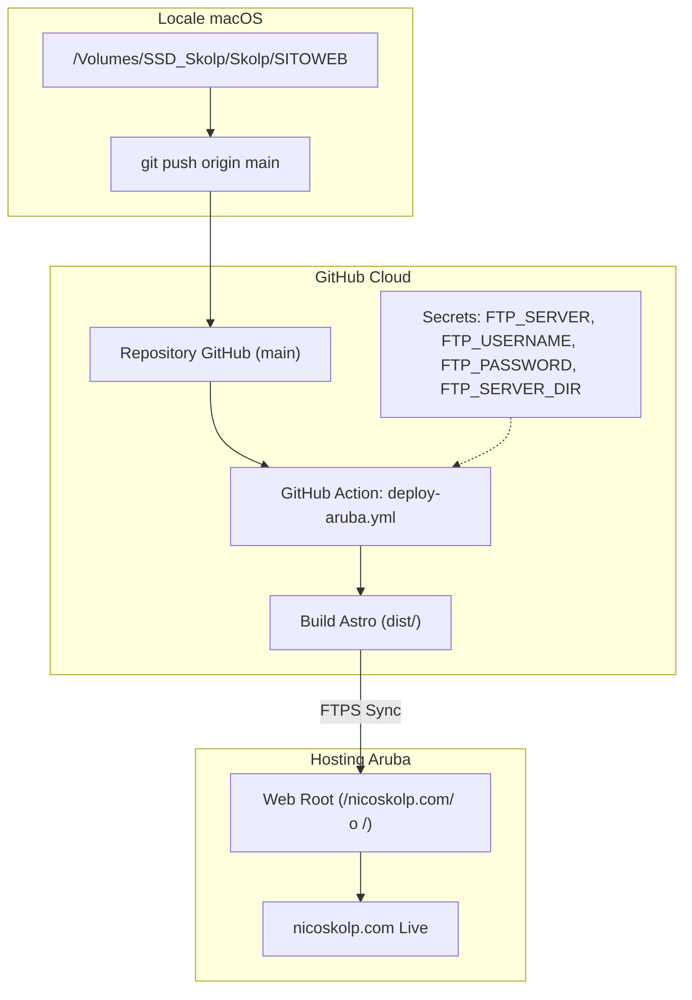

# Piano di Implementazione: Configurazione GitHub e Deploy Aruba per nicoskolp.com

> **For agentic workers:** REQUIRED SUB-SKILL: Use superpowers:subagent-driven-development to implement this plan task-by-task. Steps use checkbox (`- [ ]`) syntax for tracking.

**Goal:** Configurare l'ambiente locale in `/Volumes/SSD_Skolp/Skolp/SITOWEB`, collegare GitHub tramite GitHub CLI, creare lo skeleton di un sito moderno con Astro e Tailwind CSS, e automatizzare la pubblicazione su Hosting Linux Aruba tramite pipeline GitHub Actions FTPS.

**Architecture:** Il codice sorgente risiede in `/Volumes/SSD_Skolp/Skolp/SITOWEB` ed è versionato su GitHub sul branch `main`. A ogni push, GitHub Actions avvia un runner Ubuntu, esegue `npm run build` per generare i file statici ottimizzati in `dist/`, e sincronizza in modo incrementale i file verso l'hosting Aruba via protocollo FTPS sicuro leggendo le credenziali cifrate da GitHub Secrets.

**Architecture Diagram:**



**Tech Stack:**
- macOS / Homebrew
- GitHub CLI (`gh`) & Git
- Node.js v24+ / npm
- Astro v5+ & Tailwind CSS v4+
- GitHub Actions (`actions/checkout@v4`, `actions/setup-node@v4`, `SamKirkland/FTP-Deploy-Action@v4.3.5`)

## Global Constraints
- Percorso locale fisso: `/Volumes/SSD_Skolp/Skolp/SITOWEB`
- Nessun dato sensibile (password, token FTP) committato nel repository
- Lingua dei commenti e della documentazione: Italiano
- Repository pubblico su GitHub con branch predefinito `main`

---

### Task 1: Installazione GitHub CLI e Configurazione Credenziali Git

**Files:**
- Modifica: configurazione utente Git locale (`~/.gitconfig` o `.git/config`)

**Interfaces:**
- Consuma: Homebrew (`/opt/homebrew/bin/brew`)
- Produce: comando `gh` autenticato e valori `user.name` / `user.email` configurati in Git

- [ ] **Step 1: Installare GitHub CLI tramite Homebrew**

Eseguire da terminale:
```bash
brew install gh
```
Verifica:
```bash
gh --version
```
Atteso: output con versione di GitHub CLI (es. `gh version 2.x.x`).

- [ ] **Step 2: Configurare nome ed email utente Git**

Configurare l'identità Git globale per i commit:
```bash
git config --global user.name "Nico Skolp"
git config --global user.email "tuo-indirizzo-github@email.com"
```
Verifica:
```bash
git config --get user.name
git config --get user.email
```
Atteso: visualizzazione dei dati impostati.

- [ ] **Step 3: Autenticare GitHub CLI sul Mac**

Eseguire l'autenticazione guidata:
```bash
gh auth login -w -p https
```
Seguire le istruzioni a schermo: inserire il codice monouso generato sul browser per completare l'associazione.

Verifica:
```bash
gh auth status
```
Atteso: `Logged in to github.com account <username>`.

---

### Task 2: Inizializzazione Repository Git Locale e Remoto

**Files:**
- Crea: `/Volumes/SSD_Skolp/Skolp/SITOWEB/.gitignore`
- Crea: `/Volumes/SSD_Skolp/Skolp/SITOWEB/README.md`

**Interfaces:**
- Consuma: `gh` autenticato da Task 1
- Produce: Repository Git locale con branch `main` e repository remoto su GitHub collegato come `origin`

- [ ] **Step 1: Inizializzare il repository Git locale in SITOWEB**

```bash
cd /Volumes/SSD_Skolp/Skolp/SITOWEB
git init -b main
```
Verifica:
```bash
git status
```
Atteso: `On branch main`.

- [ ] **Step 2: Creare il file .gitignore completo**

Creare il file `/Volumes/SSD_Skolp/Skolp/SITOWEB/.gitignore` con il seguente contenuto:
```gitignore
# Dipendenze
node_modules/
.pnp
.pnp.js

# Build output
dist/
build/

# Cache di Astro e Vite
.astro/
.cache/

# Variabili d'ambiente private
.env
.env.production
.env.local
*.local

# File di sistema macOS
.DS_Store
.AppleDouble
.LSOverride
Icon
Thumbs.db
```

- [ ] **Step 3: Creare il file README.md introduttivo**

Creare il file `/Volumes/SSD_Skolp/Skolp/SITOWEB/README.md`:
```markdown
# nicoskolp.com

Sito web ufficiale e portfolio artistico di Nico Skolp.

## Tecnologie
- [Astro](https://astro.build)
- [Tailwind CSS](https://tailwindcss.com)
- Deploy automatico su Hosting Aruba tramite GitHub Actions

## Sviluppo Locale
```bash
npm install
npm run dev
```

## Build di Produzione
```bash
npm run build
```
```

- [ ] **Step 4: Eseguire il primo commit locale**

```bash
cd /Volumes/SSD_Skolp/Skolp/SITOWEB
git add .gitignore README.md docs/
git commit -m "chore: inizializzazione repository per nicoskolp.com"
```
Verifica:
```bash
git log -n 1 --oneline
```
Atteso: log del primo commit su `main`.

- [ ] **Step 5: Creare il repository remoto su GitHub e collegare il remote**

```bash
cd /Volumes/SSD_Skolp/Skolp/SITOWEB
gh repo create nicoskolp-website --public --source=. --remote=origin --push
```
Verifica:
```bash
git remote -v
```
Atteso: `origin https://github.com/<username>/nicoskolp-website (fetch)` e `(push)`.

---

### Task 3: Strutturazione del Progetto Astro con Tailwind CSS

**Files:**
- Crea: `/Volumes/SSD_Skolp/Skolp/SITOWEB/package.json`
- Crea: `/Volumes/SSD_Skolp/Skolp/SITOWEB/astro.config.mjs`
- Crea: `/Volumes/SSD_Skolp/Skolp/SITOWEB/tsconfig.json`
- Crea: `/Volumes/SSD_Skolp/Skolp/SITOWEB/src/styles/global.css`
- Crea: `/Volumes/SSD_Skolp/Skolp/SITOWEB/src/layouts/Layout.astro`
- Crea: `/Volumes/SSD_Skolp/Skolp/SITOWEB/src/pages/index.astro`

**Interfaces:**
- Consuma: Node.js e npm
- Produce: comando `npm run build` funzionante che genera output valido in `dist/`

- [x] **Step 1: Creare `package.json`**

Creare `/Volumes/SSD_Skolp/Skolp/SITOWEB/package.json`:
```json
{
  "name": "nicoskolp-website",
  "type": "module",
  "version": "1.0.0",
  "scripts": {
    "dev": "astro dev",
    "start": "astro dev",
    "build": "astro build",
    "preview": "astro preview"
  },
  "dependencies": {
    "@astrojs/check": "^0.9.4",
    "@tailwindcss/vite": "^4.0.0",
    "astro": "^5.0.0",
    "tailwindcss": "^4.0.0",
    "typescript": "^5.7.0"
  }
}
```

- [x] **Step 2: Installare le dipendenze npm**

```bash
cd /Volumes/SSD_Skolp/Skolp/SITOWEB
npm install
```
Verifica:
```bash
test -d node_modules && echo "OK"
```
Atteso: `OK`.

- [x] **Step 3: Creare `astro.config.mjs` e `tsconfig.json`**

Creare `/Volumes/SSD_Skolp/Skolp/SITOWEB/astro.config.mjs`:
```javascript
import { defineConfig } from 'astro/config';
import tailwindcss from '@tailwindcss/vite';

export default defineConfig({
  site: 'https://nicoskolp.com',
  vite: {
    plugins: [tailwindcss()],
  },
});
```

Creare `/Volumes/SSD_Skolp/Skolp/SITOWEB/tsconfig.json`:
```json
{
  "extends": "astro/tsconfigs/strict",
  "compilerOptions": {
    "strictNullChecks": true
  }
}
```

- [x] **Step 4: Creare foglio di stile e layout base**

Creare `/Volumes/SSD_Skolp/Skolp/SITOWEB/src/styles/global.css`:
```css
@import "tailwindcss";

:root {
  color-scheme: dark;
}

body {
  margin: 0;
  background-color: #0a0a0a;
  color: #f5f5f5;
  font-family: system-ui, -apple-system, BlinkMacSystemFont, 'Segoe UI', Roboto, Oxygen, Ubuntu, Cantarell, sans-serif;
}
```

Creare `/Volumes/SSD_Skolp/Skolp/SITOWEB/src/layouts/Layout.astro`:
```astro
---
interface Props {
  title?: string;
  description?: string;
}

const {
  title = "Nico Skolp | Official Portfolio",
  description = "Portfolio artistico ufficiale di Nico Skolp: Arte Urbana, Graffiti, Tele e Progetti."
} = Astro.props;

import '../styles/global.css';
---

<!doctype html>
<html lang="it">
  <head>
    <meta charset="UTF-8" />
    <meta name="viewport" content="width=device-width, initial-scale=1.0" />
    <meta name="description" content={description} />
    <title>{title}</title>
  </head>
  <body class="min-h-screen flex flex-col bg-neutral-950 text-neutral-100 antialiased selection:bg-amber-500 selection:text-black">
    <slot />
  </body>
</html>
```

- [x] **Step 5: Creare la homepage introduttiva `index.astro`**

Creare `/Volumes/SSD_Skolp/Skolp/SITOWEB/src/pages/index.astro`:
```astro
---
import Layout from '../layouts/Layout.astro';
---

<Layout title="Nico Skolp | Official Site">
  <main class="flex-1 flex flex-col items-center justify-center p-6 text-center max-w-4xl mx-auto">
    <div class="space-y-4">
      <span class="inline-block px-3 py-1 text-xs tracking-widest uppercase border border-neutral-700 rounded-full text-neutral-400">
        In Costruzione
      </span>
      <h1 class="text-5xl md:text-7xl font-extrabold tracking-tight text-white">
        NICO SKOLP
      </h1>
      <p class="text-xl md:text-2xl text-neutral-400 max-w-xl mx-auto font-light">
        Arte Urbana • Graffiti • Tele • Progetti
      </p>
    </div>

    <div class="mt-12 flex flex-wrap gap-4 justify-center">
      <a
        href="https://instagram.com/nicoskolp"
        target="_blank"
        rel="noopener noreferrer"
        class="px-6 py-3 rounded-lg bg-neutral-900 border border-neutral-800 hover:border-neutral-600 transition text-sm font-medium"
      >
        Instagram
      </a>
      <a
        href="http://linktr.ee/nicoskolp"
        target="_blank"
        rel="noopener noreferrer"
        class="px-6 py-3 rounded-lg bg-white text-black hover:bg-neutral-200 transition text-sm font-semibold"
      >
        Linktree
      </a>
    </div>

    <footer class="mt-20 text-xs text-neutral-600">
      &copy; {new Date().getFullYear()} Nico Skolp. Tutti i diritti riservati.
    </footer>
  </main>
</Layout>
```

- [x] **Step 6: Test di build locale**

Eseguire la build per verificare la correttezza del codice:
```bash
cd /Volumes/SSD_Skolp/Skolp/SITOWEB
npm run build
```
Verifica:
```bash
test -f dist/index.html && echo "BUILD SUCCESS"
```
Atteso: `BUILD SUCCESS` e creazione di `dist/index.html`.

- [x] **Step 7: Commit delle modifiche del progetto Astro**

```bash
cd /Volumes/SSD_Skolp/Skolp/SITOWEB
git add package.json package-lock.json astro.config.mjs tsconfig.json src/
git commit -m "feat: struttura iniziale sito Astro con Tailwind CSS"
git push origin main
```
Verifica:
```bash
git status
```
Atteso: `nothing to commit, working tree clean`.

---

### Task 4: Configurazione della Pipeline GitHub Actions per Deploy Aruba

**Files:**
- Crea: `/Volumes/SSD_Skolp/Skolp/SITOWEB/.github/workflows/deploy-aruba.yml`

**Interfaces:**
- Consuma: repository GitHub su branch `main` e Secrets (`FTP_SERVER`, `FTP_USERNAME`, `FTP_PASSWORD`, `FTP_SERVER_DIR`)
- Produce: job di deploy automatico eseguito ad ogni push su `main`

- [ ] **Step 1: Creare il file di workflow CI/CD**

Creare `/Volumes/SSD_Skolp/Skolp/SITOWEB/.github/workflows/deploy-aruba.yml`:
```yaml
name: Deploy su Hosting Aruba

on:
  push:
    branches:
      - main
  workflow_dispatch:

concurrency:
  group: deploy-aruba
  cancel-in-progress: false

jobs:
  build-and-deploy:
    name: Build & FTPS Deploy
    runs-on: ubuntu-latest
    steps:
      - name: 📥 Checkout repository
        uses: actions/checkout@v4
        with:
          fetch-depth: 2

      - name: ⚙️ Setup Node.js
        uses: actions/setup-node@v4
        with:
          node-version: 22
          cache: 'npm'

      - name: 📦 Installa dipendenze
        run: npm ci

      - name: 🚀 Compila sito Astro (dist)
        run: npm run build

      - name: 📤 Deploy FTPS su Aruba
        uses: SamKirkland/FTP-Deploy-Action@v4.3.5
        with:
          server: ${{ secrets.FTP_SERVER }}
          username: ${{ secrets.FTP_USERNAME }}
          password: ${{ secrets.FTP_PASSWORD }}
          server-dir: ${{ secrets.FTP_SERVER_DIR || '/' }}
          local-dir: ./dist/
          protocol: ftps
          dangerous-clean-slate: false
```

- [ ] **Step 2: Commit e push del workflow su GitHub**

```bash
cd /Volumes/SSD_Skolp/Skolp/SITOWEB
git add .github/workflows/deploy-aruba.yml
git commit -m "ci: aggiunta workflow GitHub Actions per deploy automatico FTPS su Aruba"
git push origin main
```
Verifica:
```bash
gh workflow list
```
Atteso: visualizzazione del workflow `Deploy su Hosting Aruba`.

---

### Task 5: Configurazione Secrets GitHub e Verifica Deploy Aruba

**Files:**
- Modifica: Impostazioni del repository GitHub (Secrets Actions)

**Interfaces:**
- Consuma: Credenziali FTP dell'account Aruba
- Produce: Pipeline verde con sito `nicoskolp.com` online su Aruba

- [ ] **Step 1: Impostare i Secrets su GitHub**

Utilizzare il comando `gh secret set` oppure la UI di GitHub (*Settings -> Secrets and variables -> Actions*):
```bash
cd /Volumes/SSD_Skolp/Skolp/SITOWEB
gh secret set FTP_SERVER --body "<tuo-server-ftp-aruba>"
gh secret set FTP_USERNAME --body "<tuo-username-ftp-aruba>"
gh secret set FTP_PASSWORD --body "<tua-password-ftp-aruba>"
gh secret set FTP_SERVER_DIR --body "/"
```
*(Nota: per Aruba Linux solitamente `FTP_SERVER_DIR` è `/` o `/nicoskolp.com/`)*.

- [ ] **Step 2: Avviare manualmente il workflow di test**

```bash
cd /Volumes/SSD_Skolp/Skolp/SITOWEB
gh workflow run deploy-aruba.yml
```
Verifica stato di avanzamento:
```bash
gh run list --workflow=deploy-aruba.yml -L 1
```
Atteso: stato del run in corso (`in_progress`) e poi completato con successo (`completed / success`).

- [ ] **Step 3: Verifica finale del sito su Aruba**

```bash
curl -I https://nicoskolp.com
```
Atteso: risposta HTTP 200 con la nuova pagina di Nico Skolp servita dal server Aruba.
