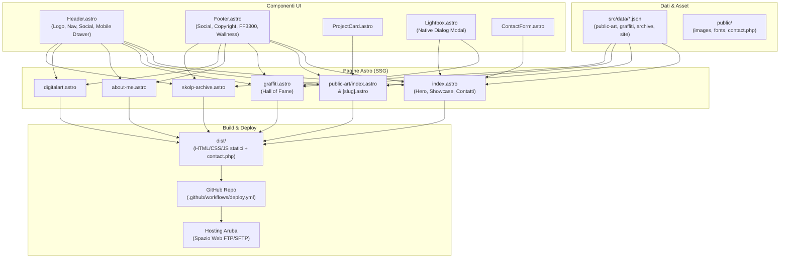

# Piano di Implementazione: Ricostruzione Sito Web Nico Skolp

> **Per gli agenti esecutori:** SUB-SKILL RICHIESTA: Utilizzare `superpowers:subagent-driven-development` per implementare questo piano task-by-task. I passaggi usano la sintassi checkbox (`- [ ]`) per il tracciamento.

**Obiettivo:** Ricostruire fedelmente l'intero sito web e portfolio di Nico Skolp da Wix ad Astro SSG, garantendo la replica esatta dello stile visivo, della tipografia e della navigazione, ottimizzato per hosting Aruba (output statico + PHP) e versionato su GitHub.

**Architettura:** Il sito è strutturato come un'applicazione statica (SSG) realizzata con Astro. I contenuti dei murales, dei graffiti e dell'archivio sono gestiti tramite file di dati JSON strutturati (`src/data/*.json`), mentre i componenti (`Header`, `Footer`, `ProjectCard`, `Lightbox`, `ContactForm`) compongono pagine veloci e responsive. Il modulo contatti invia asincronamente i dati a uno script PHP leggero (`public/contact.php`) compatibile con i server Linux di Aruba.

**Diagramma di Architettura:**



**Tech Stack:**
- Astro (SSG)
- HTML5 Semantico, CSS Moderno con Custom Properties
- Web Font locali (`Druk Text Wide`, `Open Sans`)
- TypeScript per la tipizzazione dei dati
- Script PHP leggero per il backend di contatto su Aruba
- Git & GitHub Actions per CI/CD su Aruba via FTP

## Vincoli Globali
- Fedeltà al 100% rispetto al design del sito Wix originale (`https://nicoskolp.wixsite.com/nicoskolp/it`).
- Zero librerie JS esterne pesanti; uso di `<dialog>` nativo per il Lightbox.
- Nessuna dipendenza runtime Node.js richiesta su Aruba.
- Tutte le immagini devono caricare lazy, con fallback alt text corretti.
- Comunicazione e commenti di codice in lingua italiana.

---

### Task 1: Inizializzazione Repository Git e Setup Astro

**File:**
- Crea: `package.json`
- Crea: `astro.config.mjs`
- Crea: `tsconfig.json`
- Crea: `.gitignore`
- Crea: `README.md`

**Interfacce:**
- Produce: Configurazione di base funzionante per la build statica con Astro.

- [ ] **Passaggio 1: Creazione file `.gitignore`**

```gitignore
node_modules/
dist/
.astro/
.DS_Store
.env*
```

- [ ] **Passaggio 2: Creazione `package.json` e configurazione dipendenze**

```json
{
  "name": "nicoskolp-website",
  "type": "module",
  "version": "1.0.0",
  "scripts": {
    "dev": "astro dev",
    "start": "astro dev",
    "build": "astro build",
    "preview": "astro preview"
  },
  "dependencies": {
    "astro": "^4.16.18"
  }
}
```

- [ ] **Passaggio 3: Creazione `astro.config.mjs` e `tsconfig.json`**

```javascript
import { defineConfig } from 'astro/config';

// https://astro.build/config
export default defineConfig({
  output: 'static',
  build: {
    format: 'directory'
  }
});
```

```json
{
  "extends": "astro/tsconfigs/strict",
  "compilerOptions": {
    "baseUrl": ".",
    "paths": {
      "@/*": ["src/*"]
    }
  }
}
```

- [ ] **Passaggio 4: Installazione delle dipendenze e verifica avvio**

Esegui: `npm install`
Atteso: Creazione di `node_modules/` e `package-lock.json` senza errori.

- [ ] **Passaggio 5: Inizializzazione del repository Git locale**

```bash
git init
git add .
git commit -m "chore: inizializzazione progetto Astro e configurazione git"
```

---

### Task 2: Migrazione Asset Immagini e Web Font

**File:**
- Crea: `scripts/migrate-assets.py`
- Crea: `public/fonts/druk/` (file font o fallback webfont Druk)
- Crea: `public/fonts/opensans/`
- Crea: `public/images/` (struttura cartelle: `public-art/`, `graffiti/`, `hero/`, `archive/`, `brand/`)

**Interfacce:**
- Produce: Asset grafici e fotografici in alta risoluzione organizzati e pronti per essere serviti staticamente.

- [x] **Passaggio 1: Scrittura dello script di migrazione `scripts/migrate-assets.py`**
Lo script copia i file già presenti nella cartella locale `/Volumes/SSD_Skolp/Skolp/ARTE_URBANA/Wix_site` e scarica ad alta risoluzione le immagini mancanti da `static.wixstatic.com/media/`.

- [x] **Passaggio 2: Esecuzione dello script di migrazione**
Esegui: `python3 scripts/migrate-assets.py`
Atteso: Tutte le immagini dei 22 progetti di Public Art, delle 25 foto di Graffiti, dell'Archivio e del logo Wallness/Skolp sono presenti in `public/images/`.

- [x] **Passaggio 3: Configurazione dei Web Font in `public/fonts/`**
Organizzazione dei file `@font-face` per Druk Text Wide e Open Sans (formati woff2/woff).

- [x] **Passaggio 4: Commit degli asset**

```bash
git add scripts/ public/fonts/ public/images/
git commit -m "feat: migrazione e catalogazione asset immagini e font"
```

---

### Task 3: Dati Strutturati e Tipizzazione (JSON & TypeScript)

**File:**
- Crea: `src/types/index.ts`
- Crea: `src/data/site.json`
- Crea: `src/data/public-art.json`
- Crea: `src/data/graffiti.json`
- Crea: `src/data/archive.json`

**Interfacce:**
- Produce: Schemi TypeScript e collezioni di dati complete per tutti i 22 progetti di Public Art, le 25 foto di Graffiti e l'Archivio 1999-2019.

- [x] **Passaggio 1: Definizione interfacce TypeScript in `src/types/index.ts`**

```typescript
export interface Project {
  id: string;
  slug: string;
  title: string;
  year?: string;
  city?: string;
  category: 'public-art' | 'canvas' | 'other';
  coverImage: string;
  galleryImages: string[];
  description?: string;
}

export interface GraffitiPiece {
  id: string;
  title: string;
  year?: string;
  city?: string;
  image: string;
}

export interface ArchiveItem {
  id: string;
  year: string;
  title: string;
  image: string;
}

export interface SiteConfig {
  name: string;
  tagline: string;
  subtagline: string;
  bio: string[];
  social: {
    instagram: string;
    behance: string;
  };
  credits: {
    studioName: string;
    studioUrl: string;
    collectiveName: string;
    collectiveUrl: string;
  };
}
```

- [x] **Passaggio 2: Creazione dei file JSON con i dati estratti dal sito Wix**
Scrittura di `src/data/site.json`, `src/data/public-art.json`, `src/data/graffiti.json`, `src/data/archive.json`.

- [x] **Passaggio 3: Test di caricamento dati**
Verifica con test Node che tutti i file JSON siano validi e contengano tutte le opere censite.

- [x] **Passaggio 4: Commit dei dati strutturati**

```bash
git add src/types/ src/data/
git commit -m "feat: aggiunta dati strutturati per public-art, graffiti, archivio e config"
```

---

### Task 4: Layout Base e Stili Globali (`BaseLayout`, `Header`, `Footer`)

**File:**
- Crea: `src/styles/global.css`
- Crea: `src/layouts/BaseLayout.astro`
- Crea: `src/components/Header.astro`
- Crea: `src/components/Footer.astro`

**Interfacce:**
- Consumes: `src/data/site.json`, web font
- Produces: Layout HTML semantico, testata fissa o sticky, menu responsivo, footer con crediti e social.

- [ ] **Passaggio 1: Creazione di `src/styles/global.css`**
Dichiarazione delle variabili CSS per colori, font-family (`Druk Text Wide`, `Open Sans`), reset CSS moderno, utility per griglie e tipografia.

- [ ] **Passaggio 2: Implementazione di `src/components/Header.astro`**
Logo Nico Skolp a sinistra (link a `/`), navigazione centrale/destra con `Public Art`, `About me`, `Graffiti`, icone SVG per Instagram e Behance, pulsante toggle per drawer su smartphone.

- [ ] **Passaggio 3: Implementazione di `src/components/Footer.astro`**
Link social, indicazione anno dinamica, link *"ARCHIVIO"*, link *"design by: FF3300"* e *"member of: Wallness"*.

- [ ] **Passaggio 4: Implementazione di `src/layouts/BaseLayout.astro`**
Inclusione di meta tag SEO, OpenGraph, import di `global.css`, `Header` e `Footer`, con slot centrale per il contenuto delle pagine.

- [ ] **Passaggio 5: Test visivo e verifica build**
Esegui: `npm run build`
Atteso: Compilazione con successo dei layout di base.

- [ ] **Passaggio 6: Commit**

```bash
git add src/styles/ src/layouts/ src/components/Header.astro src/components/Footer.astro
git commit -m "feat: implementazione BaseLayout, Header responsivo e Footer"
```

---

### Task 5: Homepage e Modulo Contatti per Aruba

**File:**
- Crea: `src/components/ContactForm.astro`
- Crea: `public/contact.php`
- Modifica: `src/pages/index.astro`

**Interfacce:**
- Consumes: `BaseLayout`, `src/data/site.json`, `src/data/public-art.json`
- Produces: Homepage con Hero, carosello/griglia delle 13 opere in evidenza e modulo di contatto asincrono su `contact.php`.

- [ ] **Passaggio 1: Creazione dello script PHP `public/contact.php`**
Script che riceve i parametri via POST (nome, email, messaggio), valida i campi, invia una email a Nico Skolp e risponde con `{ "success": true }`.

- [ ] **Passaggio 2: Creazione di `src/components/ContactForm.astro`**
Form con campi Nome, Cognome, Email, Oggetto, Messaggio, stato di caricamento e messaggio di conferma *"Il tuo modulo è stato inviato!"*.

- [ ] **Passaggio 3: Creazione della Homepage in `src/pages/index.astro`**
Sezione Hero con titoli:
- *"A contemporary art project about muralism."*
- *"Get face with your imagination."*
- Bottone *"Buy NFTS"* (link `/digitalart`)
Griglia con le 13 opere salienti e sezione di contatto finale.

- [ ] **Passaggio 4: Test e build della Homepage**
Esegui: `npm run build`
Atteso: Generazione di `dist/index.html` e copia di `dist/contact.php`.

- [ ] **Passaggio 5: Commit**

```bash
git add public/contact.php src/components/ContactForm.astro src/pages/index.astro
git commit -m "feat: completamento homepage con hero, vetrina e modulo contatti per Aruba"
```

---

### Task 6: Sezione Public Art e Pagine Dettaglio Murales

**File:**
- Crea: `src/components/ProjectCard.astro`
- Crea: `src/pages/public-art/index.astro`
- Crea: `src/pages/public-art/[slug].astro`
- Crea: rotte legacy per compatibilità URL (es. `/teatro-aquilone`, `/sanpaolo`, `/trust-taranto`, ecc.)

**Interfacce:**
- Consumes: `src/data/public-art.json`
- Produces: Indice portfolio Public Art e pagine individuali con foto e didascalie.

- [ ] **Passaggio 1: Creazione di `src/components/ProjectCard.astro`**
Card con immagine copertina, effetto hover, titolo dell'opera e link alla pagina di dettaglio.

- [ ] **Passaggio 2: Creazione di `src/pages/public-art/index.astro`**
Intestazione con titolo *"Public Art"* e sottotitolo *"Here, my Urban Art Porfolio. Shape and colors make me fill better."*, seguita dalla griglia con i 22 murales.

- [ ] **Passaggio 3: Creazione del template dinamico `src/pages/public-art/[slug].astro`**
Pagina di dettaglio con foto in alta risoluzione, galleria fotografica dei dettagli del murale, titolo, anno, città e descrizione.

- [ ] **Passaggio 4: Configurazione redirect o pagine alias per gli URL originali Wix**
Creazione di pagine/redirect per garantire che i link storici (es. `/teatro-aquilone`, `/sanpaolo`, `/ex-fadda`, `/matera-basket`) continuino a funzionare.

- [ ] **Passaggio 5: Test della generazione statica**
Esegui: `npm run build`
Atteso: Tutte le pagine dei singoli progetti generate correttamente in `dist/public-art/...`

- [ ] **Passaggio 6: Commit**

```bash
git add src/components/ProjectCard.astro src/pages/public-art/
git commit -m "feat: implementazione sezione Public Art e pagine dettaglio dei murales"
```

---

### Task 7: Sezione Graffiti (Hall of Fame) e Modale Lightbox

**File:**
- Crea: `src/components/Lightbox.astro`
- Crea: `src/pages/graffiti.astro`

**Interfacce:**
- Consumes: `src/data/graffiti.json`
- Produces: Galleria ad alta risoluzione con visualizzatore a tutto schermo e controlli da tastiera/touch.

- [ ] **Passaggio 1: Creazione del componente `src/components/Lightbox.astro`**
Elemento `<dialog>` nativo che si apre al clic su qualsiasi miniatura, con visualizzazione foto ingrandita, frecce Prev/Next, tasto Close, didascalia e supporto tasti ESC / Freccia Sinistra / Freccia Destra.

- [ ] **Passaggio 2: Creazione di `src/pages/graffiti.astro`**
Titoli: *"Hall of Fame selection."* e *"The 5 letters that boost my style."*. Griglia a 2-3 colonne delle 25 pareti storiche con trigger verso il Lightbox.

- [ ] **Passaggio 3: Test interattività e navigazione foto**
Verifica apertura dialog, cambio slide e chiusura senza errori console.

- [ ] **Passaggio 4: Commit**

```bash
git add src/components/Lightbox.astro src/pages/graffiti.astro
git commit -m "feat: implementazione galleria graffiti con visualizzatore Lightbox nativo"
```

---

### Task 8: Pagine Complementari (About Me, Digital Art, Archivio)

**File:**
- Crea: `src/pages/about-me.astro`
- Crea: `src/pages/digitalart.astro`
- Crea: `src/pages/skolp-archive.astro`

**Interfacce:**
- Consumes: `src/data/site.json`, `src/data/archive.json`
- Produces: Pagine secondarie perfettamente formattate e collegate.

- [ ] **Passaggio 1: Creazione di `src/pages/about-me.astro`**
Biografia formattata con la tipografia e i testi originali, link allo studio FF3300 e chiusura *"Collaboration welcomed"*.

- [ ] **Passaggio 2: Creazione di `src/pages/digitalart.astro`**
Sezione dedicata all'arte digitale, illustrazioni e progetti NFT con collegamenti esterni.

- [ ] **Passaggio 3: Creazione di `src/pages/skolp-archive.astro`**
Archivio cronologico dal 1999 al 2019+ con le foto storiche e didascalie degli anni.

- [ ] **Passaggio 4: Test e build globale**
Esegui: `npm run build`
Atteso: Tutte le pagine compilate senza errori in `dist/`.

- [ ] **Passaggio 5: Commit**

```bash
git add src/pages/about-me.astro src/pages/digitalart.astro src/pages/skolp-archive.astro
git commit -m "feat: implementazione pagine About Me, Digital Art e Archivio Storico"
```

---

### Task 9: Configurazione Workflow GitHub Actions per Aruba

**File:**
- Crea: `.github/workflows/deploy.yml`
- Aggiorna: `README.md`

**Interfacce:**
- Produces: Automazione CI/CD per pubblicare automaticamente il sito su Aruba ad ogni `git push main`.

- [ ] **Passaggio 1: Creazione di `.github/workflows/deploy.yml`**

```yaml
name: Deploy su Aruba Hosting

on:
  push:
    branches:
      - main

jobs:
  build-and-deploy:
    runs-on: ubuntu-latest
    steps:
      - name: Checkout del codice
        uses: actions/checkout@v4

      - name: Setup Node.js
        uses: actions/setup-node@v4
        with:
          node-version: 20
          cache: 'npm'

      - name: Installazione dipendenze
        run: npm ci

      - name: Compilazione statica del sito
        run: npm run build

      - name: Sincronizzazione FTP su Aruba
        uses: SamKirkland/FTP-Deploy-Action@v4.3.5
        with:
          server: ${{ secrets.FTP_SERVER }}
          username: ${{ secrets.FTP_USERNAME }}
          password: ${{ secrets.FTP_PASSWORD }}
          local-dir: ./dist/
          server-dir: ./
```

- [ ] **Passaggio 2: Aggiornamento della documentazione `README.md`**
Istruzioni chiare su:
- Come avviare il sito in locale (`npm run dev`)
- Come compilare il sito (`npm run build`)
- Come impostare i Secrets su GitHub (`FTP_SERVER`, `FTP_USERNAME`, `FTP_PASSWORD`) per il deploy automatico su Aruba.
- Come caricare manualmente la cartella `dist/` se non si desidera usare GitHub Actions.

- [ ] **Passaggio 3: Commit della configurazione CI/CD**

```bash
git add .github/workflows/deploy.yml README.md
git commit -m "ci: configurazione GitHub Actions per il deploy automatico su Aruba"
```

---

### Task 10: Verifica Finale, Audit Prestazioni e Validazione

**File:**
- Tutti i file del progetto

**Interfacce:**
- Produces: Repository pronto, testato e validato per la produzione.

- [ ] **Passaggio 1: Esecuzione build di produzione pulita**
Esegui: `npm run build`
Atteso: Codice di uscita 0, nessun errore di build.

- [ ] **Passaggio 2: Verifica della cartella `dist/`**
Verifica che tutti i file HTML, gli asset statici (`images/`, `fonts/`) e `contact.php` siano presenti in `dist/`.

- [ ] **Passaggio 3: Test con preview locale**
Esegui: `npm run preview` e verifica la navigazione tra le pagine, la visualizzazione mobile e il funzionamento del Lightbox.

- [ ] **Passaggio 4: Commit e tagging di versione**

```bash
git add .
git commit -m "chore: rilascio versione 1.0.0 pronta per deploy su Aruba"
git tag -a v1.0.0 -m "Versione 1.0.0 - Ricostruzione completa sito Nico Skolp"
```
