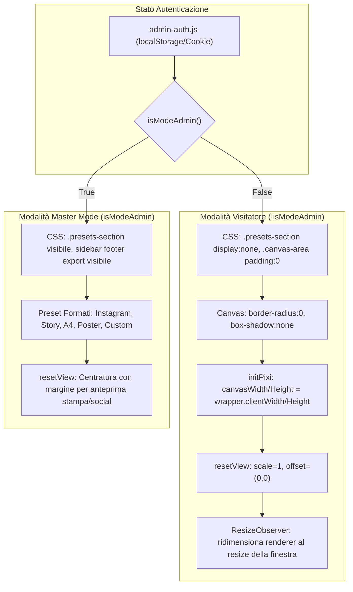

# Piano di Implementazione: Canvas a Tutta Area & Rimozione Formati per Visitatori

> **For agentic workers:** REQUIRED SUB-SKILL: Use superpowers:subagent-driven-development to implement this plan task-by-task. Steps use checkbox (`- [ ]`) syntax for tracking.

**Goal:** Rimuovere la selezione dei formati tela per i visitatori non loggati in tutte le 6 applicazioni del LAB e far occupare al canvas PixiJS l'intera area visiva disponibile a risoluzione nativa e con resize reattivo.

**Architecture:** Modifica del foglio di stile globale delle 6 web-app con regole CSS basate su `:not(.admin-mode)`. Nello script `main.js` di ciascuna app, quando l'utente non è autenticato come admin, le dimensioni della tela (`state.canvasWidth`, `state.canvasHeight`) vengono calcolate in tempo reale sulla base del contenitore `#canvas-wrapper` (`clientWidth` e `clientHeight`), eliminando offset e zoom proporzionali fittizi. Un `ResizeObserver` garantisce che al ridimensionamento del browser o del dispositivo il canvas ricalcoli la composizione procedurale per la nuova risoluzione. In modalità Admin (`.admin-mode`), la sezione formati rimane attiva con i formati fissi (Post, Story, A4, Poster, Custom) e l'anteprima incorniciata per l'esportazione.

**Architecture Diagram:**



**Tech Stack:** JavaScript ES Modules, PixiJS v8, CSS3 (Scoped Dark Theme), HTML5 ResizeObserver API, Vite, Astro, GitHub Actions (FTPS Aruba).

## Global Constraints

- Tutte le comunicazioni e la documentazione devono essere rigorosamente in lingua italiana.
- Nessuna libreria runtime esterna aggiuntiva (utilizzare le API native di PixiJS e ResizeObserver del browser).
- Compatibilità totale con l'architettura `admin-auth.js` (`.admin-mode`).
- Tutte le modifiche ai sorgenti in `Skolptura_app/*/web-app/src` devono essere compilate con Vite e distribuite in `public/lab/*/`.
- Il comando `npm run check && npm run build && npm run audit` deve terminare con 0 errori prima del deploy.

---

### Task 1: Aggiornamento CSS per Visitatori in tutte le 6 App

**Files:**
- Modify: `Skolptura_app/BRIO/web-app/src/style.css`
- Modify: `Skolptura_app/CAPSULE/web-app/src/style.css`
- Modify: `Skolptura_app/DOOMENO/web-app/src/style.css`
- Modify: `Skolptura_app/GRIDSHAPE/web-app/src/style.css`
- Modify: `Skolptura_app/LETSHIFT/web-app/src/style.css`
- Modify: `Skolptura_app/LOGIC RIBBON/web-app/src/style.css`

**Interfaces:**
- Consumes: `.admin-mode` applicata da `admin-auth.js` su `<html>` e `<body>`.
- Produces: Regole CSS che nascondono `.presets-section`, azzerano il padding di `.canvas-area`, rimuovono ombre e raggio di curvatura da `#canvas-wrapper canvas`, e nascondono il pulsante `#immersive-preview-btn` per utenti non-admin.

- [ ] **Step 1: Aggiungi le regole CSS in tutti i 6 `style.css`**

Aggiungere in coda a ciascun file `style.css`:
```css
/* ==========================================================================
   MODALITÀ VISITATORE: HIDE FORMATS & FULL AREA CANVAS
   ========================================================================== */
body:not(.admin-mode) .presets-section,
html:not(.admin-mode) .presets-section {
  display: none !important;
}

body:not(.admin-mode) .canvas-area,
html:not(.admin-mode) .canvas-area {
  padding: 0 !important;
}

body:not(.admin-mode) #canvas-wrapper canvas,
html:not(.admin-mode) #canvas-wrapper canvas {
  border-radius: 0 !important;
  box-shadow: none !important;
}

body:not(.admin-mode) .immersive-btn,
html:not(.admin-mode) .immersive-btn {
  display: none !important;
}
```

- [ ] **Step 2: Verifica sintattica e commit**

```bash
git add Skolptura_app/*/web-app/src/style.css
git commit -m "style(lab): regole CSS per rimozione formati e canvas full-area per non-admin"
```

---

### Task 2: Logica Canvas a Piena Area in BRIO e CAPSULE

**Files:**
- Modify: `Skolptura_app/BRIO/web-app/src/main.js`
- Modify: `Skolptura_app/CAPSULE/web-app/src/main.js`

**Interfaces:**
- Consumes: `window.isSkolpAdmin()`, `document.getElementById('canvas-wrapper')`.
- Produces: Calcolo dinamico di `canvasWidth` e `canvasHeight` basato su `wrapper.clientWidth` e `clientHeight` all'avvio, `resetView()` a scala 1:1 e `ResizeObserver` per BRIO e CAPSULE.

- [ ] **Step 1: Integra helper `isModeAdmin()` e aggiorna `initPixi()`**

In `main.js`:
```javascript
function isModeAdmin() {
  return (typeof window.isSkolpAdmin === 'function' && window.isSkolpAdmin()) ||
         localStorage.getItem('skolp_admin_mode') === 'true';
}
```

In `initPixi()`:
```javascript
  const wrapper = document.getElementById('canvas-wrapper');
  if (!isModeAdmin() && wrapper) {
    const rect = wrapper.getBoundingClientRect();
    if (rect.width > 0 && rect.height > 0) {
      state.canvasWidth = Math.max(300, Math.round(rect.width));
      state.canvasHeight = Math.max(300, Math.round(rect.height));
    }
  }
```

- [ ] **Step 2: Aggiorna `resetView()` per visitatori**

```javascript
function resetView() {
  const wrapper = document.getElementById('canvas-wrapper');
  if (!wrapper) return;
  const wrapperRect = wrapper.getBoundingClientRect();
  
  if (!isModeAdmin()) {
    state.viewScale = 1.0;
    state.viewOffset = { x: 0, y: 0 };
    updateViewTransform();
    return;
  }
  
  const scaleX = wrapperRect.width / state.canvasWidth;
  const scaleY = wrapperRect.height / state.canvasHeight;
  state.viewScale = Math.min(scaleX, scaleY) * 0.95;
  
  state.viewOffset = {
    x: (wrapperRect.width - state.canvasWidth * state.viewScale) / 2,
    y: (wrapperRect.height - state.canvasHeight * state.viewScale) / 2
  };

  updateViewTransform();
}
```

- [ ] **Step 3: Aggiungi `ResizeObserver` su `#canvas-wrapper`**

In coda a `initPixi()`:
```javascript
  if (!isModeAdmin() && wrapper) {
    let resizeTimer = null;
    const ro = new ResizeObserver(() => {
      if (isModeAdmin()) return;
      clearTimeout(resizeTimer);
      resizeTimer = setTimeout(() => {
        if (!wrapper || !app || !app.renderer) return;
        const rect = wrapper.getBoundingClientRect();
        const newW = Math.max(300, Math.round(rect.width));
        const newH = Math.max(300, Math.round(rect.height));
        if (newW !== state.canvasWidth || newH !== state.canvasHeight) {
          state.canvasWidth = newW;
          state.canvasHeight = newH;
          app.renderer.resize(newW, newH);
          resetView();
          renderScene();
        }
      }, 150);
    });
    ro.observe(wrapper);
  }
```

- [ ] **Step 4: Verifica e commit per BRIO e CAPSULE**

```bash
git add Skolptura_app/BRIO/web-app/src/main.js Skolptura_app/CAPSULE/web-app/src/main.js
git commit -m "feat(lab): canvas dinamico full-area e resize reattivo in Brio e Capsule"
```

---

### Task 3: Logica Canvas a Piena Area in DOOMENO e GRIDSHAPE

**Files:**
- Modify: `Skolptura_app/DOOMENO/web-app/src/main.js`
- Modify: `Skolptura_app/GRIDSHAPE/web-app/src/main.js`

**Interfaces:**
- Consumes: `window.isSkolpAdmin()`, `document.getElementById('canvas-wrapper')`.
- Produces: Calcolo dinamico di `canvasWidth` e `canvasHeight` basato su `wrapper.clientWidth` e `clientHeight` all'avvio, `resetView()` a scala 1:1 e `ResizeObserver` per DOOMENO e GRIDSHAPE.

- [ ] **Step 1: Integra `isModeAdmin()`, dimensionamento iniziale in `initPixi()`, `resetView()` e `ResizeObserver` su DOOMENO**
- [ ] **Step 2: Integra `isModeAdmin()`, dimensionamento iniziale in `initPixi()`, `resetView()` e `ResizeObserver` su GRIDSHAPE**
- [ ] **Step 3: Verifica e commit per DOOMENO e GRIDSHAPE**

```bash
git add Skolptura_app/DOOMENO/web-app/src/main.js Skolptura_app/GRIDSHAPE/web-app/src/main.js
git commit -m "feat(lab): canvas dinamico full-area e resize reattivo in Doomeno e Gridshape"
```

---

### Task 4: Logica Canvas a Piena Area in LETSHIFT e LOGIC RIBBON

**Files:**
- Modify: `Skolptura_app/LETSHIFT/web-app/src/main.js`
- Modify: `Skolptura_app/LOGIC RIBBON/web-app/src/main.js`

**Interfaces:**
- Consumes: `window.isSkolpAdmin()`, `document.getElementById('canvas-wrapper')`.
- Produces: Calcolo dinamico di `canvasWidth` e `canvasHeight` basato su `wrapper.clientWidth` e `clientHeight` all'avvio, `resetView()` a scala 1:1 e `ResizeObserver` per LETSHIFT e LOGIC RIBBON.

- [ ] **Step 1: Integra `isModeAdmin()`, dimensionamento iniziale in `initPixi()`, `resetView()` e `ResizeObserver` su LETSHIFT**
- [ ] **Step 2: Integra `isModeAdmin()`, dimensionamento iniziale in `initPixi()`, `resetView()` e `ResizeObserver` su LOGIC RIBBON**
- [ ] **Step 3: Verifica e commit per LETSHIFT e LOGIC RIBBON**

```bash
git add Skolptura_app/LETSHIFT/web-app/src/main.js "Skolptura_app/LOGIC RIBBON/web-app/src/main.js"
git commit -m "feat(lab): canvas dinamico full-area e resize reattivo in Letshift e Logic Ribbon"
```

---

### Task 5: Aggiornamento Hub (`public/lab/index.html`)

**Files:**
- Modify: `public/lab/index.html`

**Interfaces:**
- Consumes: Testi descrittivi dell'Hub.
- Produces: Allineamento della sezione "Funzionalità & Controlli" (Workflow) affinché la descrizione del Canvas evidenzi l'esperienza immersiva a tutto schermo per i visitatori.

- [ ] **Step 1: Aggiorna la card Canvas nell'Hub**

Modificare la card "Formati Canvas & Aspect Ratio" per descrivere l'adattamento dinamico al display del visitatore.
- [ ] **Step 2: Commit**

```bash
git add public/lab/index.html
git commit -m "docs(lab): aggiornamento copy workflow canvas nell'Hub"
```

---

### Task 6: Compilazione Vite di tutte e 6 le App, Build Astro, Audit e Deploy Aruba

**Files:**
- Update: `public/lab/brio/*`
- Update: `public/lab/capsule/*`
- Update: `public/lab/doomeno/*`
- Update: `public/lab/gridshape/*`
- Update: `public/lab/letshift/*`
- Update: `public/lab/logic-ribbon/*`

**Interfaces:**
- Consumes: Codice sorgente compilato in `dist/` di ciascuna app.
- Produces: File di produzione aggiornati e sincronizzati via FTPS su Aruba.

- [ ] **Step 1: Esegui build Vite per tutte e 6 le app**

```bash
npm --prefix "Skolptura_app/BRIO/web-app" run build
npm --prefix "Skolptura_app/CAPSULE/web-app" run build
npm --prefix "Skolptura_app/DOOMENO/web-app" run build
npm --prefix "Skolptura_app/GRIDSHAPE/web-app" run build
npm --prefix "Skolptura_app/LETSHIFT/web-app" run build
npm --prefix "Skolptura_app/LOGIC RIBBON/web-app" run build
```

- [ ] **Step 2: Sincronizza i file compilati nelle cartelle `public/lab/`**

Copiare i file `dist/*` nei percorsi corrispondenti `public/lab/*/`.
Assicurarsi che `<script src="/lab/admin-auth.js"></script>` sia presente nel `<head>` di ciascun `index.html`.

- [ ] **Step 3: Esegui i controlli qualità Astro**

```bash
npm run check && npm run build && npm run audit
```
Verificare 0 errori e 0 warnings.

- [ ] **Step 4: Commit e Push per avviare il deploy FTPS su Aruba**

```bash
git add public/lab/
git commit -m "feat(lab): build di produzione con canvas full-area per visitatori e deploy Aruba"
git push origin main
```

- [ ] **Step 5: Monitora il completamento con `gh run watch`**
