# Piano di Implementazione: Miglioramenti Mobile & Interfaccia Skolptura Lab

> **Per agenti operativi:** SUB-SKILL RICHIESTO: Usa `superpowers:subagent-driven-development` per implementare questo piano task per task. I passaggi utilizzano la sintassi checkbox (`- [ ]`) per il tracciamento.

**Obiettivo:** Ottimizzare l'esperienza mobile e l'interfaccia delle 6 applicazioni del LAB (Brio, Capsule, Doomeno, Gridshape, Letshift, Logic Ribbon): aggiungere frecce stepper verticali squadrate (`▲` / `▼`) con autorepeat per tutti i campi numerici, allineare la GUI mobile di Logic Ribbon in basso sotto il canvas, squadrare e rendere bianco il tasto `← Skolptura Lab`, e ripristinare il corretto funzionamento dello "Sfondo Esteso" su desktop e mobile.

**Architettura:** L'aggiornamento unifica markup e stile CSS brutalist/dark su tutte le 6 applicazioni. Un modulo JS condiviso `setupSteppers()` inietta dinamicamente i pulsanti di incremento/decremento su ciascun `.slider-container` e `input[type="number"]`, intercettando eventi `click`, `mousedown` e `touchstart` per gestire sia il singolo scatto sia l'autorepeat su pressione prolungata, dispacciando l'evento standard `input` che aggiorna reattivamente lo stato e il canvas PixiJS. La gestione dello "Sfondo Esteso" viene corretta permettendo a `.canvas-area` di aggiornare la variabile CSS `--canvas-area-bg` con il colore della scena, rimuovendo le restrizioni `!important` e garantendo la visibilità del controllo a tutti gli utenti.

**Diagramma di Architettura:**

```mermaid
graph TD
    subgraph "Controlli & Input GUI"
        SC[".slider-container / input[type=number]"] --> STEP["setupSteppers() (JS Injection)"]
        STEP --> BTNS["Bottoni Squadrati ▲ / ▼"]
        BTNS -->|Click / Touch / Autorepeat| EVT["input.stepUp() / stepDown() + dispatchEvent('input')"]
        EVT --> STATE["Aggiornamento State & renderScene()"]
    end

    subgraph "Responsive Layout (max-width: 900px)"
        CONT[".app-container"] -->|flex-direction: column| CV["Canvas Top (60vh)"]
        CONT --> SB["Sidebar Bottom (100% width)"]
    end

    subgraph "Sfondo Esteso (#immersive-preview-btn)"
        IBTN["Bottone 👁 Sfondo Esteso"] -->|Click| TGL["state.immersiveMode toggle"]
        TGL --> CSSVAR["canvasArea.style.setProperty('--canvas-area-bg', scene.bg)"]
        CSSVAR --> BGDOM["Colorazione Sfondo Viewport"]
    end

    subgraph "Navigazione"
        BACK["a.hub-back-btn ← Skolptura Lab"] -->|Stile Squadrato & Bianco| LAB["Ritorno all'Hub /lab"]
    end
```



**Stack Tecnologico:** Vanilla JavaScript (ES Modules), CSS3 (Flexbox/Grid, CSS Variables, Media Queries), PixiJS v8, Vite, Astro, GitHub Actions (FTPS Deploy Aruba).

## Vincoli Globali

- Lingua obbligatoria per piani e comunicazioni: Italiano (`<RULE[user_global]>`).
- Stile grafico coerente: Brutalist minimalista, angoli rigorosamente squadrati (`border-radius: 0px`), palette scura (`#000000`, `#0a0a0a`, `#141414`), testi bianchi `#ffffff`, accenti hover invertiti (`#ffffff` / `#000000`).
- Compatibilità touch: target touch minimi di 22x14px per pulsante stepper con padding touch-friendly, supporto `touchstart`/`touchend` con autorepeat (300ms delay, 60ms interval).
- Nessun impatto negativo sulla modalità Admin (`?skolp=admin` o `Ctrl + Shift + S`).

---

### Task 1: Stili CSS Globali (Pulsante Torna a Lab, Steppers Squadrati, Mobile Logic Ribbon, Sfondo Esteso)

**File:**
- Modifica: `Skolptura_app/BRIO/web-app/src/style.css`
- Modifica: `Skolptura_app/CAPSULE/web-app/src/style.css`
- Modifica: `Skolptura_app/DOOMENO/web-app/src/style.css`
- Modifica: `Skolptura_app/GRIDSHAPE/web-app/src/style.css`
- Modifica: `Skolptura_app/LETSHIFT/web-app/src/style.css`
- Modifica: `Skolptura_app/LOGIC RIBBON/web-app/src/style.css`

**Interfacce:**
- Produce: Classi `.hub-back-btn`, `.stepper-controls`, `.stepper-btn`, `.stepper-up`, `.stepper-down`, supporto `--canvas-area-bg` su `.canvas-area`, e blocco responsive `@media (max-width: 900px)` in Logic Ribbon.

- [ ] **Passaggio 1: Aggiungi stili per `.hub-back-btn` e controlli `.stepper-controls` in tutti i 6 `style.css`**

In ciascuno dei 6 file `Skolptura_app/*/web-app/src/style.css`, aggiungi:

```css
/* Tasto Torna al Lab Unificato Squadrato e Bianco */
.hub-back-btn {
  display: inline-flex !important;
  align-items: center !important;
  gap: 6px !important;
  padding: 4px 10px !important;
  background: #000000 !important;
  color: #ffffff !important;
  border: 1px solid #333333 !important;
  border-radius: 0px !important;
  font-family: 'Open Sans', system-ui, sans-serif !important;
  font-size: 11px !important;
  font-weight: 600 !important;
  letter-spacing: 0.06em !important;
  text-transform: uppercase !important;
  text-decoration: none !important;
  box-shadow: none !important;
  transition: all 0.15s ease !important;
}

.hub-back-btn:hover {
  background: #ffffff !important;
  color: #000000 !important;
  border-color: #ffffff !important;
}

/* Stepper Numerici Squadrati Verticali ▲ / ▼ */
.slider-container {
  display: flex;
  align-items: center;
  gap: 8px;
}

.stepper-controls {
  display: inline-flex;
  flex-direction: column;
  gap: 1px;
  width: 22px;
  flex-shrink: 0;
  user-select: none;
  -webkit-user-select: none;
}

.stepper-btn {
  display: flex;
  align-items: center;
  justify-content: center;
  width: 22px;
  height: 14px;
  padding: 0;
  background: #111111;
  color: #ffffff;
  border: 1px solid #333333;
  border-radius: 0px !important;
  font-size: 7px;
  line-height: 1;
  cursor: pointer;
  touch-action: manipulation;
  transition: background-color 0.1s, color 0.1s, border-color 0.1s;
}

.stepper-btn:hover,
.stepper-btn:active {
  background: #ffffff;
  color: #000000;
  border-color: #ffffff;
}
```

- [ ] **Passaggio 2: Inserisci `@media (max-width: 900px)` in `LOGIC RIBBON/web-app/src/style.css`**

Aggiungi prima della sezione Brand Alignment:

```css
/* RESPONSIVE LOGIC RIBBON (Mobile Layout in Basso) */
@media (max-width: 900px) {
  .app-container {
    flex-direction: column;
    overflow-y: auto;
  }
  
  .canvas-area {
    height: 60vh;
    min-height: 400px;
    flex: none;
  }
  
  .sidebar {
    width: 100%;
    height: auto;
    flex: 1;
    border-left: none;
    border-top: 1px solid var(--panel-border);
  }
  
  .accordion {
    max-height: 500px;
  }
}
```

- [ ] **Passaggio 3: Correggi `.canvas-area` e `.immersive-btn` in tutti i 6 `style.css`**

Sostituisci:
```css
.canvas-area {
  background-color: #000000 !important;
}
```
con:
```css
.canvas-area {
  background-color: var(--canvas-area-bg, #000000);
  transition: background-color 0.3s ease;
}
```

Uniforma `.immersive-btn` squadrato e posizionato in alto a destra:
```css
.immersive-btn {
  position: absolute;
  top: 16px;
  right: 16px;
  left: auto !important;
  z-index: 50;
  background: rgba(10, 10, 10, 0.85);
  backdrop-filter: blur(8px);
  -webkit-backdrop-filter: blur(8px);
  border: 1px solid #333333;
  border-radius: 0px !important;
  color: #ffffff;
  padding: 6px 12px;
  font-family: 'Open Sans', system-ui, sans-serif;
  font-weight: 600;
  font-size: 11px;
  letter-spacing: 0.04em;
  text-transform: uppercase;
  cursor: pointer;
  display: flex;
  align-items: center;
  gap: 6px;
  box-shadow: 0 4px 14px rgba(0, 0, 0, 0.6);
  transition: all 0.15s ease;
}

.immersive-btn:hover {
  background: rgba(255, 255, 255, 0.15);
  border-color: #ffffff;
}

.immersive-btn.active {
  background: #ffffff !important;
  border-color: #ffffff !important;
  color: #000000 !important;
}
```

Rimuovi le regole che nascondevano `.immersive-btn` per i non-admin:
```css
/* Rimuovere:
body:not(.admin-mode) .immersive-btn,
html:not(.admin-mode) .immersive-btn {
  display: none !important;
}
*/
```

- [ ] **Passaggio 4: Verifica con grep che non vi siano regole residue che nascondano `.immersive-btn`**

Esegui:
```bash
grep -rn "immersive-btn" Skolptura_app/*/web-app/src/style.css | grep "none"
```
Output atteso: 0 righe trovate.

- [ ] **Passaggio 5: Commit delle modifiche CSS**

```bash
git add Skolptura_app/*/web-app/src/style.css
git commit -m "style(lab): stili hub-back-btn squadrato, steppers verticali, mobile logic ribbon e fix sfondo esteso"
```

---

### Task 2: Markup HTML (`index.html` delle 6 App)

**File:**
- Modifica: `Skolptura_app/BRIO/web-app/index.html`
- Modifica: `Skolptura_app/CAPSULE/web-app/index.html`
- Modifica: `Skolptura_app/DOOMENO/web-app/index.html`
- Modifica: `Skolptura_app/GRIDSHAPE/web-app/index.html`
- Modifica: `Skolptura_app/LETSHIFT/web-app/index.html`
- Modifica: `Skolptura_app/LOGIC RIBBON/web-app/index.html`

- [ ] **Passaggio 1: Sostituisci il link inline ciano con `class="hub-back-btn"` in tutti i 6 `index.html`**

Cerca la riga:
```html
<a href="/lab" style="color: #00f2fe; text-decoration: none; font-size: 11px; font-weight: 600; text-transform: uppercase; letter-spacing: 0.06em; display: inline-flex; align-items: center; gap: 4px; padding: 3px 8px; border-radius: 4px; background: rgba(0, 242, 254, 0.08); border: 1px solid rgba(0, 242, 254, 0.25);">&larr; Skolptura Lab</a>
```
Sostituisci con:
```html
<a href="/lab" class="hub-back-btn">&larr; Skolptura Lab</a>
```

- [ ] **Passaggio 2: Verifica l'assenza totale di riferimenti a `#00f2fe` in tutti i 6 `index.html`**

Esegui:
```bash
grep -rn "#00f2fe" Skolptura_app/*/web-app/index.html
```
Output atteso: 0 corrispondenze.

- [ ] **Passaggio 3: Commit delle modifiche HTML**

```bash
git add Skolptura_app/*/web-app/index.html
git commit -m "feat(lab): adozione classe hub-back-btn squadrata e rimozione stile ciano inline"
```

---

### Task 3: Logica JavaScript (Stepper con Autorepeat & Sfondo Esteso in BRIO, CAPSULE, DOOMENO)

**File:**
- Modifica: `Skolptura_app/BRIO/web-app/src/main.js`
- Modifica: `Skolptura_app/CAPSULE/web-app/src/main.js`
- Modifica: `Skolptura_app/DOOMENO/web-app/src/main.js`

**Interfacce:**
- Funzione `setupSteppers()`:
  - Cerca tutti i `.slider-container` con `input[type="range"]` e inserisce il blocco `.stepper-controls`.
  - Associa eventi `click`, `mousedown` e `touchstart` su `stepper-up` (`input.stepUp()`) e `stepper-down` (`input.stepDown()`) con autorepeat su pressione prolungata.
  - Dispaccia `new Event('input', { bubbles: true })`.
- Gestione Sfondo Esteso:
  - In `init()`: `immersiveBtn.addEventListener('click', ...)` sincronizza classe `active` su pulsante e `immersive-mode` su `document.body` e richiama `renderScene()`.
  - In `renderScene()`: aggiorna `--canvas-area-bg` di `.canvas-area`.

- [ ] **Passaggio 1: Scrivi la funzione `setupSteppers()` in `Skolptura_app/BRIO/web-app/src/main.js`**

Aggiungi prima dell'inizializzazione dei controlli:

```javascript
function setupSteppers() {
  const containers = document.querySelectorAll('.slider-container');
  containers.forEach(container => {
    const input = container.querySelector('input[type="range"]');
    if (!input || container.querySelector('.stepper-controls')) return;

    const controls = document.createElement('div');
    controls.className = 'stepper-controls';

    const btnUp = document.createElement('button');
    btnUp.type = 'button';
    btnUp.className = 'stepper-btn stepper-up';
    btnUp.setAttribute('aria-label', 'Aumenta valore');
    btnUp.textContent = '▲';

    const btnDown = document.createElement('button');
    btnDown.type = 'button';
    btnDown.className = 'stepper-btn stepper-down';
    btnDown.setAttribute('aria-label', 'Diminuisci valore');
    btnDown.textContent = '▼';

    controls.appendChild(btnUp);
    controls.appendChild(btnDown);
    container.appendChild(controls);

    const changeVal = (delta) => {
      try {
        if (delta > 0) input.stepUp();
        else input.stepDown();
      } catch (err) {
        const step = parseFloat(input.step) || 1;
        const current = parseFloat(input.value) || 0;
        input.value = current + (delta > 0 ? step : -step);
      }
      input.dispatchEvent(new Event('input', { bubbles: true }));
    };

    const attachAutoRepeat = (btn, delta) => {
      let timeoutId = null;
      let intervalId = null;

      const start = (e) => {
        if (e.type === 'touchstart') e.preventDefault();
        changeVal(delta);
        timeoutId = setTimeout(() => {
          intervalId = setInterval(() => {
            changeVal(delta);
          }, 60);
        }, 300);
      };

      const stop = () => {
        if (timeoutId) { clearTimeout(timeoutId); timeoutId = null; }
        if (intervalId) { clearInterval(intervalId); intervalId = null; }
      };

      btn.addEventListener('mousedown', start);
      btn.addEventListener('mouseup', stop);
      btn.addEventListener('mouseleave', stop);
      btn.addEventListener('touchstart', start, { passive: false });
      btn.addEventListener('touchend', stop);
      btn.addEventListener('touchcancel', stop);
    };

    attachAutoRepeat(btnUp, 1);
    attachAutoRepeat(btnDown, -1);
  });
}
```

Invoca `setupSteppers()` alla fine dell'inizializzazione dell'interfaccia.

- [ ] **Passaggio 2: Aggiorna Sfondo Esteso in `BRIO/web-app/src/main.js`**

1. Nel listener di `#immersive-preview-btn`:
```javascript
  const immersiveBtn = document.getElementById('immersive-preview-btn');
  if (immersiveBtn) {
    immersiveBtn.addEventListener('click', () => {
      state.immersiveMode = !state.immersiveMode;
      immersiveBtn.classList.toggle('active', state.immersiveMode);
      document.body.classList.toggle('immersive-mode', state.immersiveMode);
      renderScene();
    });
  }
```

2. In `renderScene()` (intorno alla riga 1230):
```javascript
  const canvasArea = document.querySelector('.canvas-area');
  if (canvasArea) {
    if (state.immersiveMode) {
      canvasArea.style.setProperty('--canvas-area-bg', bgColor);
      canvasArea.style.backgroundColor = bgColor;
      if (app.canvas) app.canvas.style.boxShadow = 'none';
    } else {
      canvasArea.style.removeProperty('--canvas-area-bg');
      canvasArea.style.backgroundColor = '';
      if (app.canvas) app.canvas.style.boxShadow = '';
    }
  }
```

- [ ] **Passaggio 3: Replica `setupSteppers()` e fix Sfondo Esteso in `CAPSULE/web-app/src/main.js`**

In `Skolptura_app/CAPSULE/web-app/src/main.js`:
- Inserisci `setupSteppers()` e invocala alla fine di `initUI()`.
- Nel listener `#immersive-preview-btn` (riga 749), aggiungi `document.body.classList.toggle('immersive-mode', state.immersiveMode);` e `renderScene();`.
- In `renderScene()` (riga 354), aggiorna `--canvas-area-bg`:
```javascript
  const canvasArea = document.querySelector('.canvas-area');
  if (canvasArea) {
    if (state.immersiveMode) {
      canvasArea.style.setProperty('--canvas-area-bg', scene.backgroundColor);
      canvasArea.style.backgroundColor = scene.backgroundColor;
      if (app.canvas) app.canvas.style.boxShadow = 'none';
    } else {
      canvasArea.style.removeProperty('--canvas-area-bg');
      canvasArea.style.backgroundColor = '';
      if (app.canvas) app.canvas.style.boxShadow = '';
    }
  }
```

- [ ] **Passaggio 4: Replica `setupSteppers()` e fix Sfondo Esteso in `DOOMENO/web-app/src/main.js`**

In `Skolptura_app/DOOMENO/web-app/src/main.js`:
- Inserisci `setupSteppers()` e invocala all'avvio dell'interfaccia.
- Allinea listener `#immersive-preview-btn` e gestione `--canvas-area-bg` in `renderScene()`.

- [ ] **Passaggio 5: Commit delle modifiche JS per Brio, Capsule e Doomeno**

```bash
git add Skolptura_app/BRIO/web-app/src/main.js Skolptura_app/CAPSULE/web-app/src/main.js Skolptura_app/DOOMENO/web-app/src/main.js
git commit -m "feat(lab): steppers con autorepeat e fix sfondo esteso in Brio, Capsule e Doomeno"
```

---

### Task 4: Logica JavaScript (Stepper con Autorepeat & Sfondo Esteso in GRIDSHAPE, LETSHIFT, LOGIC RIBBON)

**File:**
- Modifica: `Skolptura_app/GRIDSHAPE/web-app/src/main.js`
- Modifica: `Skolptura_app/LETSHIFT/web-app/src/main.js`
- Modifica: `Skolptura_app/LOGIC RIBBON/web-app/src/main.js`

- [ ] **Passaggio 1: Integra `setupSteppers()` e fix Sfondo Esteso in `GRIDSHAPE/web-app/src/main.js`**

In `Skolptura_app/GRIDSHAPE/web-app/src/main.js`:
- Inserisci `setupSteppers()` e invocala alla fine dell'aggancio eventi.
- Nel listener `#immersive-preview-btn` e in `renderScene()` (riga 338), applica `--canvas-area-bg` con `scene.backgroundColor`.

- [ ] **Passaggio 2: Integra `setupSteppers()` e fix Sfondo Esteso in `LETSHIFT/web-app/src/main.js`**

In `Skolptura_app/LETSHIFT/web-app/src/main.js`:
- Inserisci `setupSteppers()` e invocala alla fine dell'aggancio eventi.
- Nel listener `#immersive-preview-btn` e in `renderScene()` (riga 351), applica `--canvas-area-bg` con `scene.backgroundColor`.

- [ ] **Passaggio 3: Integra `setupSteppers()` e fix Sfondo Esteso in `LOGIC RIBBON/web-app/src/main.js`**

In `Skolptura_app/LOGIC RIBBON/web-app/src/main.js`:
- Inserisci `setupSteppers()` e invocala alla fine dell'aggancio eventi.
- Nel listener `#immersive-preview-btn` e in `renderScene()` (riga 315), imposta:
```javascript
  const canvasArea = document.querySelector('.canvas-area');
  if (canvasArea) {
    if (state.immersiveMode) {
      canvasArea.style.setProperty('--canvas-area-bg', currentSceneData.backgroundColor);
      canvasArea.style.backgroundColor = currentSceneData.backgroundColor;
      if (app.canvas) app.canvas.style.boxShadow = 'none';
    } else {
      canvasArea.style.removeProperty('--canvas-area-bg');
      canvasArea.style.backgroundColor = '';
      if (app.canvas) app.canvas.style.boxShadow = '';
    }
  }
```

- [ ] **Passaggio 4: Commit delle modifiche JS per Gridshape, Letshift e Logic Ribbon**

```bash
git add Skolptura_app/GRIDSHAPE/web-app/src/main.js Skolptura_app/LETSHIFT/web-app/src/main.js "Skolptura_app/LOGIC RIBBON/web-app/src/main.js"
git commit -m "feat(lab): steppers con autorepeat e fix sfondo esteso in Gridshape, Letshift e Logic Ribbon"
```

---

### Task 5: Compilazione Vite di tutte e 6 le App, Build Astro, Audit e Deploy Aruba

**File:**
- Directory sorgenti: `Skolptura_app/*/web-app/dist/`
- Directory distribuzione: `public/lab/*/`

- [ ] **Passaggio 1: Compilazione Vite per ciascuna delle 6 app**

Esegui:
```bash
npm --prefix "Skolptura_app/BRIO/web-app" run build
npm --prefix "Skolptura_app/CAPSULE/web-app" run build
npm --prefix "Skolptura_app/DOOMENO/web-app" run build
npm --prefix "Skolptura_app/GRIDSHAPE/web-app" run build
npm --prefix "Skolptura_app/LETSHIFT/web-app" run build
npm --prefix "Skolptura_app/LOGIC RIBBON/web-app" run build
```

- [ ] **Passaggio 2: Sincronizzazione dei file generati in `public/lab/<app>/`**

Esegui:
```bash
rm -rf public/lab/brio/assets/* && cp -R Skolptura_app/BRIO/web-app/dist/* public/lab/brio/
rm -rf public/lab/capsule/assets/* && cp -R Skolptura_app/CAPSULE/web-app/dist/* public/lab/capsule/
rm -rf public/lab/doomeno/assets/* && cp -R Skolptura_app/DOOMENO/web-app/dist/* public/lab/doomeno/
rm -rf public/lab/gridshape/assets/* && cp -R Skolptura_app/GRIDSHAPE/web-app/dist/* public/lab/gridshape/
rm -rf public/lab/letshift/assets/* && cp -R Skolptura_app/LETSHIFT/web-app/dist/* public/lab/letshift/
rm -rf public/lab/logic-ribbon/assets/* && cp -R "Skolptura_app/LOGIC RIBBON/web-app/dist/"* public/lab/logic-ribbon/
```

- [ ] **Passaggio 3: Verifica dei requisiti nei file distribuiti in `public/lab/`**

1. Verifica che non ci siano riferimenti ciano `#00f2fe`:
   `grep -rn "#00f2fe" public/lab/*/index.html` (deve restituire 0).
2. Verifica la presenza di `hub-back-btn` in tutti i 6 `public/lab/*/index.html`.
3. Verifica la presenza di `<script src="/lab/admin-auth.js"></script>` in `<head>` di tutti i 6 `public/lab/*/index.html`.

- [ ] **Passaggio 4: Esegui controlli qualità Astro**

Nella radice del repository (`/Volumes/SSD_Skolp/Skolp/SITOWEB`):
```bash
npm run check && npm run build && npm run audit
```
Output atteso: 0 errori, 0 warnings.

- [ ] **Passaggio 5: Commit e push su `main` per avviare il deploy FTPS**

```bash
git add public/lab/
git commit -m "feat(lab): build di produzione con steppers, mobile layout e sfondo esteso funzionante"
git push origin main
```

- [ ] **Passaggio 6: Monitora l'esecuzione del workflow GitHub Actions**

Esegui:
```bash
gh run list -L 1
```
Attendi il completamento con status `completed` e conclusion `success`.
