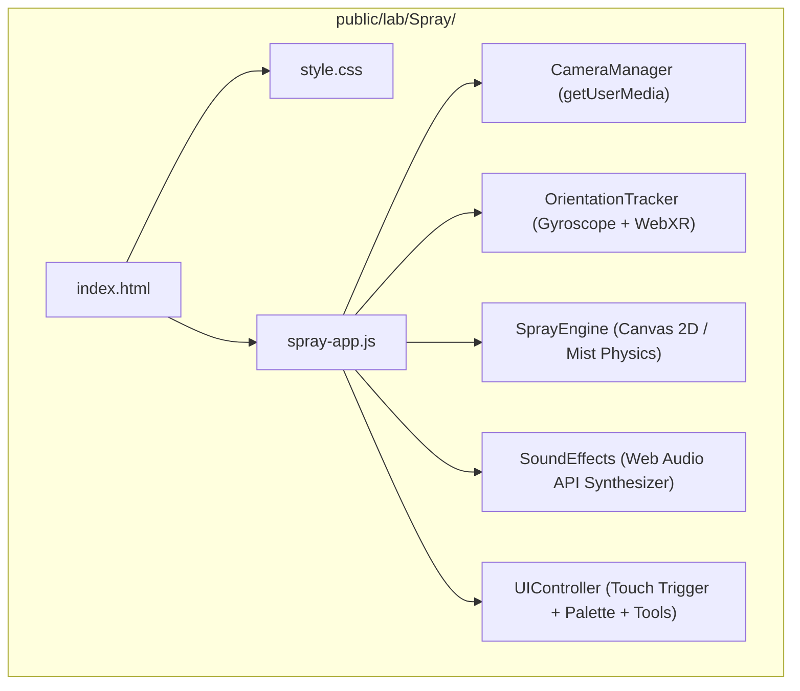

# Piano di Implementazione — Simulatore Spray Phone AR

> **Per agenti esecutori:** SOTTOSKILL RICHIESTA: Utilizza superpowers:subagent-driven-development per implementare questo piano task per task. I passaggi usano la sintassi checkbox (`- [ ]`) per il monitoraggio.

**Obiettivo:** Creare un simulatore sperimentale da browser per smartphone che trasforma il telefono in una bomboletta spray da graffiti in Realtà Aumentata con fotocamera reale, tracciamento giroscopico/orientamento, grilletto touch continuo e resa realistica dello spray su `https://www.nicoskolp.com/lab/Spray/`.

**Architettura:** Architettura ibrida a doppio motore (WebXR per Android compatibili + Camera Passthrough ad alta risoluzione con raycast 3D da giroscopio per iPhone/Safari). Un canvas ad alte prestazioni sovrapposto al video della fotocamera posteriore dipinge particelle polverizzate realistiche con Web Audio API sintetico per il sibilo aerosol.

**Diagramma Architettura:**



**Tech Stack:** Vanilla JavaScript (ES6+), HTML5 Canvas, Web Audio API, MediaDevices API (`getUserMedia`), DeviceOrientation API, Three.js / WebXR API (opzionale/progressive enhancement).

## Vincoli Globali

- Percorso file sul server: `public/lab/Spray/` (accessibile su `https://www.nicoskolp.com/lab/Spray/`).
- Nessun collegamento dal menu principale né dalla lista in `public/lab/index.html` (il progetto deve rimanere isolato e sperimentale).
- Zero dipendenze pesanti o build step complessi: deve funzionare direttamente come bundle statico servito da Apache su Aruba.
- Piena compatibilità con iOS Safari (con gestione obbligatoria di `DeviceOrientationEvent.requestPermission()` su touch utente) e Android Chrome.

---

### Task 1: Scaffolding e Layout Mobile Fullscreen

**File:**
- Crea: `/Volumes/SSD_Skolp/Skolp/SITOWEB/public/lab/Spray/index.html`
- Crea: `/Volumes/SSD_Skolp/Skolp/SITOWEB/public/lab/Spray/style.css`

**Interfacce:**
- Produce: Struttura DOM con video elemento background (`#camera-video`), canvas di pittura (`#spray-canvas`), mirino centrale (`#reticle`), grilletto touch (`#spray-trigger`), barra colori (`#palette-bar`), barra strumenti (`#top-bar`) e schermata iniziale permessi (`#start-screen`).

- [ ] **Passaggio 1: Creazione della pagina HTML semantica**
  Scrivere `index.html` con i tag viewport per disabilitare pinch-to-zoom (`user-scalable=no, viewport-fit=cover`), gli elementi strutturali e il caricamento di `style.css` e `spray-app.js`.

- [ ] **Passaggio 2: Creazione dello stile CSS per mobile full-screen**
  Scrivere `style.css` con `height: 100dvh`, blocco scroll (`overflow: hidden`), `touch-action: none`, `user-select: none`, posizionamento assoluto a strati (video in fondo z-index 1, canvas a z-index 2, mirino a z-index 3, UI controlli a z-index 10).

- [ ] **Passaggio 3: Verifica statica e render visivo**
  Verificare la correttezza del markup e degli stili controllando che la struttura sia priva di errori di sintassi.

- [ ] **Passaggio 4: Commit**
  ```bash
  git -C /Volumes/SSD_Skolp/Skolp/SITOWEB add public/lab/Spray/index.html public/lab/Spray/style.css
  git -C /Volumes/SSD_Skolp/Skolp/SITOWEB commit -m "feat(spray): aggiunge scaffolding html e css per spray phone ar"
  ```

---

### Task 2: Modulo Camera Passthrough e Gestione Permessi

**File:**
- Crea: `/Volumes/SSD_Skolp/Skolp/SITOWEB/public/lab/Spray/spray-app.js` (classe `CameraManager`)

**Interfacce:**
- Produce: `CameraManager.init()`, `CameraManager.stop()`, video feed attivo su `#camera-video`.

- [ ] **Passaggio 1: Implementazione di `CameraManager`**
  Implementare la richiesta dello stream con `navigator.mediaDevices.getUserMedia({ video: { facingMode: { ideal: "environment" }, width: { ideal: 1920 }, height: { ideal: 1080 } }, audio: false })`.
  Gestire l'attributo `playsinline`, `autoplay`, `muted` sull'elemento video per garantire l'avvio automatico su iOS Safari.

- [ ] **Passaggio 2: Gestione Fallback e Permessi Negati**
  Se la camera non è disponibile o l'utente nega il permesso, attivare un fallback visivo elegante (muro con griglia scura/pattern cemento) senza bloccare l'esperienza.

- [ ] **Passaggio 3: Schermata iniziale di sblocco ("ATTIVA SPRAY AR")**
  Implementare l'evento di sblocco su `#start-btn`: un singolo tap utente sblocca contemporaneamente stream video, context audio e autorizzazione giroscopio.

- [ ] **Passaggio 4: Commit**
  ```bash
  git -C /Volumes/SSD_Skolp/Skolp/SITOWEB add public/lab/Spray/spray-app.js
  git -C /Volumes/SSD_Skolp/Skolp/SITOWEB commit -m "feat(spray): implementa camera manager e schermata sblocco permessi"
  ```

---

### Task 3: Tracking Orientamento e Calibrazione Parete (OrientationTracker)

**File:**
- Modifica: `/Volumes/SSD_Skolp/Skolp/SITOWEB/public/lab/Spray/spray-app.js` (classe `OrientationTracker`)

**Interfacce:**
- Produce: `OrientationTracker.start()`, `OrientationTracker.recenter()`, `OrientationTracker.getNormalizedPoint() -> { x, y }`.

- [ ] **Passaggio 1: Richiesta permessi iOS WebKit**
  Supportare `typeof DeviceOrientationEvent.requestPermission === 'function'` per invocare il prompt nativo di Apple su tocco utente.

- [ ] **Passaggio 2: Calcolo proiezioni angolari e centering**
  Registrare l'evento `deviceorientation` (alpha, beta, gamma).
  Implementare `recenter()`: memorizza gli angoli di riferimento `refAlpha` e `refBeta` come centro (0, 0).
  Calcolare lo scostamento angolare convertendolo in coordinate pixel `(x, y)` sul canvas dello spray, con fattore di sensibilità regolabile e filtro di smoothing (interpolaizone lineare lerp) per eliminare il tremolio naturale della mano.

- [ ] **Passaggio 3: Supporto fallback Mouse/Desktop per debug rapido**
  Ascoltare `mousemove` per consentire il collaudo istantaneo da browser desktop o devtools.

- [ ] **Passaggio 4: Commit**
  ```bash
  git -C /Volumes/SSD_Skolp/Skolp/SITOWEB add public/lab/Spray/spray-app.js
  git -C /Volumes/SSD_Skolp/Skolp/SITOWEB commit -m "feat(spray): implementa orientation tracker con recenter e smoothing"
  ```

---

### Task 4: Motore Grafico di Spruzzo Realistico (SprayEngine)

**File:**
- Modifica: `/Volumes/SSD_Skolp/Skolp/SITOWEB/public/lab/Spray/spray-app.js` (classe `SprayEngine`)

**Interfacce:**
- Consumes: Coordinate `(x, y)` da `OrientationTracker`.
- Produces: `SprayEngine.sprayAt(x, y)`, `SprayEngine.clear()`, `SprayEngine.setColor(hex)`, `SprayEngine.setCap(type)`.

- [ ] **Passaggio 1: Inizializzazione Canvas ad alta densità (Retina display)**
  Configurare il canvas moltiplicando le dimensioni per `window.devicePixelRatio` per garantire una resa grafica nitidissima su smartphone.

- [ ] **Passaggio 2: Algoritmo di polverizzazione particellare (Overspray)**
  Per ogni frame di erogazione, disegnare:
  1. Un gradiente radiale morbido al centro con opacità progressiva.
  2. Una serie di micro-particelle casuali con distribuzione gaussiana attorno al punto d'impatto (per simulare la nube di vernice aerosol).
  3. Supporto per `skinny` (raggio 18px, getto concentrato) e `fat` (raggio 65px, getto allargato e vaporizzato).

- [ ] **Passaggio 3: Funzioni di azzeramento e gestione colori**
  Implementare `clear()` per pulire il canvas e `setColor(color)` con gestione trasparenza per stratificazione realistica del colore.

- [ ] **Passaggio 4: Commit**
  ```bash
  git -C /Volumes/SSD_Skolp/Skolp/SITOWEB add public/lab/Spray/spray-app.js
  git -C /Volumes/SSD_Skolp/Skolp/SITOWEB commit -m "feat(spray): implementa spray engine con fisica di polverizzazione aerosol"
  ```

---

### Task 5: Sintetizzatore Audio e Controlli Touch Ergonomici

**File:**
- Modifica: `/Volumes/SSD_Skolp/Skolp/SITOWEB/public/lab/Spray/spray-app.js` (classi `SoundEffects` e `UIController`)

**Interfacce:**
- Produces: `SoundEffects.startHiss()`, `SoundEffects.stopHiss()`, `SoundEffects.playShake()`.
- Gestisce: `touchstart`, `touchend`, `pointerdown`, `pointerup` per l'erogazione continua.

- [ ] **Passaggio 1: Generatore audio sibilo aerosol sintetico**
  Utilizzare la Web Audio API con un buffer di rumore bianco (`AudioBuffer`), fatto passare attraverso un `BiquadFilterNode` (filtro passa-banda centrato su 2800 Hz) e controllato da un `GainNode` con dissolvenza rapida (attack/release morbidi senza click audio). Nessun file audio esterno da scaricare!

- [ ] **Passaggio 2: Grilletto Touch Ergonomico**
  Configurare l'area touch principale in modo che poggiare il pollice attivi il ciclo di spruzzo a 60 FPS (`requestAnimationFrame`) e avvii il sibilo audio; al rilascio del pollice, il flusso si arresta istantaneamente.

- [ ] **Passaggio 3: Toolbar di controllo e palette colori**
  Collegare i pulsanti della palette: Nero (`#0a0a0a`), Bianco (`#ffffff`), Cromo (`#d0d0d8`), Rosso (`#ff2222`), Giallo (`#ffee00`), Ciano (`#00f0ff`).
  Collegare i pulsanti "Skinny / Fat Cap", "Centra Muro" e "Pulisci Muro".

- [ ] **Passaggio 4: Commit**
  ```bash
  git -C /Volumes/SSD_Skolp/Skolp/SITOWEB add public/lab/Spray/spray-app.js
  git -C /Volumes/SSD_Skolp/Skolp/SITOWEB commit -m "feat(spray): aggiunge sintetizzatore audio aerosol e controlli touch ergonomici"
  ```

---

### Task 6: Copia in Local Workspace, Deploy su GitHub e Verifica dal Vivo

**File:**
- Replica in: `/Users/nicoskolp/Documents/App/Graffiti_simulator/`
- Deploy via: `/Volumes/SSD_Skolp/Skolp/SITOWEB`

- [ ] **Passaggio 1: Copia speculare dei file in `/Users/nicoskolp/Documents/App/Graffiti_simulator/`**
  Copiare `index.html`, `style.css` e `spray-app.js` nella cartella di lavoro corrente per mantenere il progetto archiviato anche localmente.

- [ ] **Passaggio 2: Validazione preliminare e check lint/build**
  Eseguire `npm run test:data` nel repository di destinazione per verificare che nessun asset del sito sia alterato.

- [ ] **Passaggio 3: Git Push su branch `main` e monitoraggio deploy**
  Effettuare `git push origin main` su `nicoskolp-website` e verificare lo stato del workflow GitHub Actions `Deploy su Hosting Aruba`.

- [ ] **Passaggio 4: Collaudo live su URL**
  Verificare la risposta HTTP di `https://www.nicoskolp.com/lab/Spray/` e fornire il link e il QR code per testare subito con lo smartphone.
