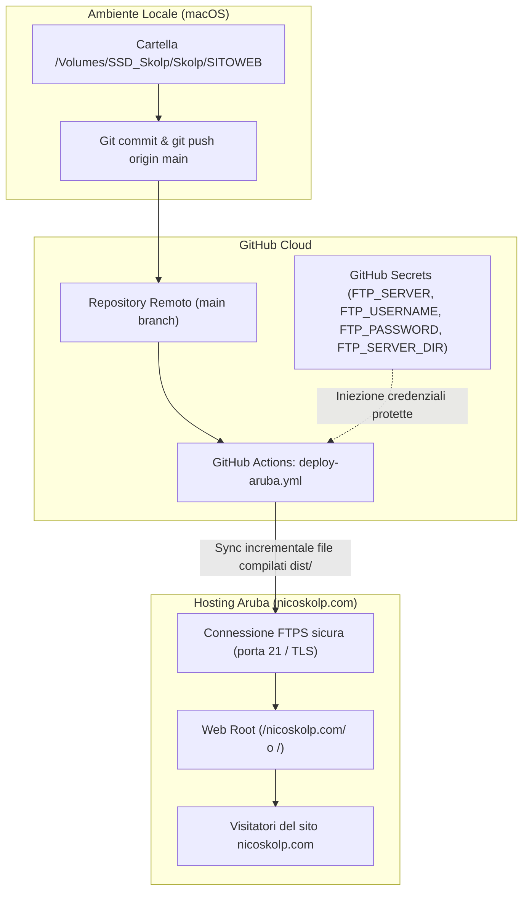

# Specifica di Design: Configurazione GitHub e Deploy Automatico Aruba per nicoskolp.com

- **Data**: 2026-10-15
- **Dominio di riferimento**: `nicoskolp.com`
- **Hosting di destinazione**: Aruba Linux Hosting
- **Repository**: GitHub (pubblico)
- **Framework sito**: Astro + Tailwind CSS

---

## 1. Obiettivi e Ambito

L'obiettivo è consentire la gestione completa, il versionamento del codice e la pubblicazione automatica del sito web `nicoskolp.com` tramite GitHub.
Ogni aggiornamento inviato al branch `main` del repository deve innescare automaticamente una pipeline di build e sincronizzazione dei file statici verso lo spazio web acquistato su Aruba via FTPS protetto.

---

## 2. Architettura della Soluzione



---

## 3. Configurazione Git & Autenticazione GitHub

### 3.1 GitHub CLI (`gh`)
- Installazione di GitHub CLI su macOS tramite Homebrew:
  ```bash
  brew install gh
  ```
- Autenticazione con procedura guidata browser:
  ```bash
  gh auth login
  ```
  (Scelta protocollo HTTPS/SSH, autenticazione con browser e memorizzazione credenziali nel portachiavi di macOS).

### 3.2 Inizializzazione Git
- Configurazione globale (o locale) di `user.name` e `user.email`.
- Inizializzazione della cartella `/Volumes/SSD_Skolp/Skolp/SITOWEB` con `git init -b main`.
- Creazione del repository remoto GitHub tramite `gh repo create` (visibilità pubblica).

---

## 4. Struttura del Progetto Web (Astro + Tailwind CSS)

Il sito sarà strutturato con Astro, ideale per portfolio artistici e ad alte prestazioni visive:

```
/Volumes/SSD_Skolp/Skolp/SITOWEB/
├── .github/
│   └── workflows/
│       └── deploy-aruba.yml        # Workflow CI/CD GitHub Actions
├── docs/
│   └── superpowers/
│       └── specs/                  # Documentazione e specifiche
├── public/                         # Asset statici diretti (favicon, CNAME, robots.txt)
├── src/
│   ├── assets/                     # Immagini ad alta risoluzione (ottimizzate in WebP)
│   ├── components/                 # Componenti UI (Navbar, Footer, Gallery)
│   ├── layouts/                    # Layout HTML con metatag e SEO
│   └── pages/                      # Pagine (index.astro, ecc.)
├── astro.config.mjs                # Configurazione Astro
├── package.json                    # Script npm (dev, build, preview)
├── tailwind.config.mjs             # Configurazione stili Tailwind
└── .gitignore                      # Esclusione di node_modules/, dist/, .env
```

---

## 5. Pipeline CI/CD GitHub Actions (`deploy-aruba.yml`)

### 5.1 Trigger
La pipeline si attiva a ogni `push` sul branch `main` oppure manualmente tramite `workflow_dispatch`.

### 5.2 Fasi del Workflow
1. **Checkout**: scarica il codice del repository.
2. **Setup Node.js**: configura l'ambiente Node (v20 o v22) e abilita la cache dei pacchetti npm per esecuzioni veloci.
3. **Install & Build**:
   ```bash
   npm ci
   npm run build
   ```
   Genera il sito ottimizzato nella cartella `dist/`.
4. **Deploy FTPS su Aruba**:
   Utilizza l'action standard `SamKirkland/FTP-Deploy-Action@v4.3.5`:
   - Protocollo: FTPS (FTP over TLS/SSL)
   - Cartella sorgente: `dist/`
   - Cartella destinazione: definita da `FTP_SERVER_DIR` (tipicamente `/` o `/nicoskolp.com/`)
   - Modalità sincrona differenziale: trasferisce unicamente i file nuovi o modificati, eliminando automaticamente i file obsoleti rimossi.

---

## 6. Gestione delle Credenziali Protette (GitHub Secrets)

Nel repository GitHub (sezione *Settings -> Secrets and variables -> Actions*) verranno configurati:
- `FTP_SERVER`: host del server FTP Aruba (es. `ftp.nicoskolp.com` o IP Aruba).
- `FTP_USERNAME`: utente FTP Aruba (es. `xxxxxxx@aruba.it`).
- `FTP_PASSWORD`: password dell'account FTP.
- `FTP_SERVER_DIR`: percorso web root del dominio su Aruba.

Nessuna credenziale sensibile risiederà nel codice tracciato da Git.

---

## 7. Verifica e Collaudo

1. Verifica compilazione locale: `npm run build` deve produrre l'output in `dist/` senza errori o warning critici.
2. Verifica connessione Git: `git push origin main` con esito positivo verso GitHub.
3. Verifica esecuzione Action: la tab *Actions* del repository deve mostrare la spunta verde sul job di deploy.
4. Verifica online: apertura di `https://nicoskolp.com` (o via HTTP/HTTPS Aruba) per validare l'effettiva presenza della nuova pagina pubblicata.
