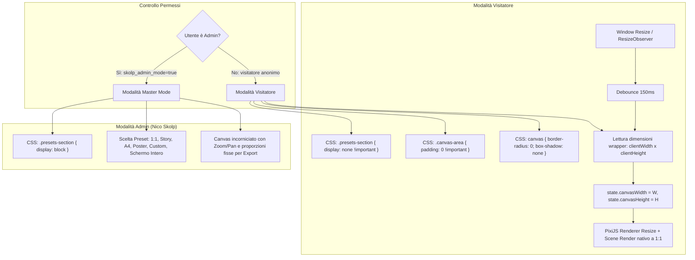

# Specifiche Tecniche: Canvas a Tutta Area & Rimozione Formati per Visitatori

**Data:** 2026-10-21  
**Autore:** Antigravity & Nico Skolp  
**Stato:** In fase di revisione  

---

## 1. Obiettivi & Visione d'Insieme

Garantire un'esperienza visiva immersiva e su misura per i visitatori del **LAB** di Nico Skolp (`/lab/`), mantenendo al contempo gli strumenti professionali e i formati di output a disposizione esclusiva dell'Admin (Nico Skolp).

### Requisiti Chiave
1. **Per Utenti Non-Admin (Visitatori Comuni):**
   - **Rimozione Sezione Formati:** La sezione `.presets-section` ("Formato Tela" con dropdown e campi numerici cm/px) deve essere completamente nascosta dalla barra dei parametri.
   - **Canvas a Tutta Area (Full Area Viewport):** Il canvas deve occupare fluidamente il 100% dello spazio visivo disponibile a fianco della sidebar (`.canvas-area`), eliminando margini esterni (padding 0), bordi arrotondati e ombre proiettate.
   - **Risoluzione Nativa & Responsive:** All'avvio e al ridimensionamento della finestra (`ResizeObserver`), il motore PixiJS ridimensiona la risoluzione interna (`canvasWidth` e `canvasHeight`) alle esatte dimensioni in pixel del contenitore, rigenerando l'opera procedurale senza bande nere, sgranature o ritagli forzati.
2. **Per Utente Admin (Nico Skolp / Master Mode):**
   - **Pieno Controllo Formati:** La sezione "Formato Tela" rimane visibile e operativa con tutti i preset social (1:1, Story 9:16, Post Verticale) e stampa 300 DPI (A4, A3, Poster 50x70 cm, Custom).
   - **Anteprima Scheda & Esportazione:** Il canvas rispetta il formato selezionato con centratura, zoom/pan e cornice di riferimento per l'esportazione di PNG e SVG ad alta risoluzione.
   - **Nuovo Preset "Schermo Intero":** Aggiunta dell'opzione "Schermo Intero (Area Totale)" nel selettore formati per consentire all'Admin di lavorare sia con i formati fissi sia a piena area.

---

## 2. Architettura & Flusso Operativo



---

## 3. Specifiche Dettagliate dei Componenti

### 3.1. Regole CSS in `style.css` (Tutte le 6 App)
Nei file `style.css` delle 6 applicazioni (`BRIO`, `CAPSULE`, `DOOMENO`, `GRIDSHAPE`, `LETSHIFT`, `LOGIC RIBBON`):

```css
/* ======================================================== */
/* MODALITÀ VISITATORE: NO FORMATI & CANVAS A TUTTA AREA    */
/* ======================================================== */
body:not(.admin-mode) .presets-section,
html:not(.admin-mode) .presets-section {
  display: none !important;
}

body:not(.admin-mode) .canvas-area,
html:not(.admin-mode) .canvas-area {
  padding: 0 !important;
}

body:not(.admin-mode) #canvas-wrapper canvas,
html:not(.admin-mode) #canvas-wrapper canvas {
  border-radius: 0 !important;
  box-shadow: none !important;
}

body:not(.admin-mode) .immersive-btn,
html:not(.admin-mode) .immersive-btn {
  display: none !important;
}
```

### 3.2. Logica di Calcolo Dimensioni in `main.js`
In ciascuna applicazione:
1. **Funzione helper `isModeAdmin()`**:
   ```javascript
   function isModeAdmin() {
     return (typeof window.isSkolpAdmin === 'function' && window.isSkolpAdmin()) ||
            localStorage.getItem('skolp_admin_mode') === 'true';
   }
   ```
2. **Dimensionamento Iniziale (`initPixi`)**:
   - Se `!isModeAdmin()`:
     ```javascript
     const wrapper = document.getElementById('canvas-wrapper');
     const rect = wrapper.getBoundingClientRect();
     state.canvasWidth = Math.max(300, Math.round(rect.width));
     state.canvasHeight = Math.max(300, Math.round(rect.height));
     state.viewScale = 1.0;
     state.viewOffset = { x: 0, y: 0 };
     ```
3. **Gestione del `resetView()`**:
   - In modalità visitatore, la visualizzazione è sempre 1:1 perfettamente allineata all'angolo in alto a sinistra (nessun offset o zoom che crei barre nere):
     ```javascript
     function resetView() {
       if (!isModeAdmin()) {
         state.viewScale = 1.0;
         state.viewOffset = { x: 0, y: 0 };
         updateViewTransform();
         return;
       }
       // Logica di centratura proporzionale per Admin (conservata)
       ...
     }
     ```
4. **Listener Resize Reattivo**:
   - Collegamento di un `ResizeObserver` su `#canvas-wrapper`:
     ```javascript
     const resizeObserver = new ResizeObserver(() => {
       if (isModeAdmin()) return; // In modalità admin le dimensioni sono regolate dal preset
       clearTimeout(resizeTimeout);
       resizeTimeout = setTimeout(() => {
         const wrapper = document.getElementById('canvas-wrapper');
         if (!wrapper || !app) return;
         const rect = wrapper.getBoundingClientRect();
         const newW = Math.max(300, Math.round(rect.width));
         const newH = Math.max(300, Math.round(rect.height));
         if (newW !== state.canvasWidth || newH !== state.canvasHeight) {
           state.canvasWidth = newW;
           state.canvasHeight = newH;
           app.renderer.resize(newW, newH);
           resetView();
           renderScene();
         }
       }, 150);
     });
     resizeObserver.observe(wrapper);
     ```

### 3.3. Hub del LAB (`public/lab/index.html`)
- Nel box della guida "Workflow" ("Formati Canvas & Aspect Ratio"), applicare la classe per mostrare la descrizione solo quando pertinente o contestualizzarla affinché sia coerente con l'esperienza di navigazione.

---

## 4. Matrice di Test & Validazione

| Applicazione | Visitatore (Anonimo) | Admin (`?skolp=admin`) |
| :--- | :--- | :--- |
| **Brio** | Sezione formati nascosta, tracciati a tutto schermo, resize reattivo fluido | Sezione formati attiva, export sbloccato |
| **Capsule** | Sezione formati nascosta, capsule a tutto schermo, zero bordi o ombre | Sezione formati attiva, export sbloccato |
| **Doomeno** | Sezione formati nascosta, matrice tessere a tutto schermo edge-to-edge | Sezione formati attiva, export sbloccato |
| **Gridshape** | Sezione formati nascosta, griglia astratta estesa a tutto il viewport | Sezione formati attiva, export sbloccato |
| **Letshift** | Sezione formati nascosta, slittamenti tipografici su tutto il canvas | Sezione formati attiva, export sbloccato |
| **Logic Ribbon** | Sezione formati nascosta, nastri curvilinei fluidi su tutta l'area | Sezione formati attiva, export sbloccato |

---

## 5. Piano di Rilascio
1. Applicazione modifiche nei sorgenti `Skolptura_app/*/web-app/src/{style.css, main.js}`.
2. Compilazione Vite di tutte e 6 le app e aggiornamento delle cartelle in `public/lab/*/`.
3. Verifica locale con `npm run check`, `npm run build` e `npm run audit`.
4. Deploy automatico via Git & FTPS su hosting Linux Aruba.
