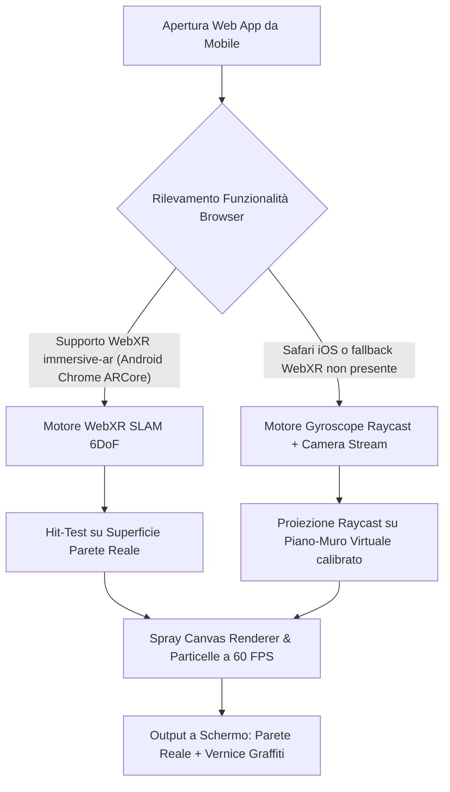

# Design Doc — Simulatore Spray Phone AR (Web Mobile)

## 1. Obiettivo e Visione
Creare un simulatore web sperimentale per smartphone che trasforma il telefono in una vera e propria bomboletta spray per graffiti. Impugnando il telefono e muovendolo davanti a una parete fisica reale, l'utente vede attraverso lo schermo la parete inquadrata dalla fotocamera posteriore (Realtà Aumentata) e può spruzzare vernice in tempo reale tenendo premuto il grilletto touch sul display.

Il progetto è collocato come strumento standalone in `https://www.nicoskolp.com/lab/Spray/` (tramite la cartella `public/lab/Spray/` nel repository `nicoskolp-website`), senza collegamenti con il menu del sito principale né con la pagina lab.

---

## 2. Architettura Tecnica a Doppio Motore (Ibrido Intelligente)

Per garantire la piena compatibilità immediata sia su **iPhone (iOS Safari)** sia su **Android (Google Chrome)**:

### 2.1 Modulo Camera Feed (`camera-stream.js`)
- Utilizza `navigator.mediaDevices.getUserMedia({ video: { facingMode: { ideal: "environment" }, width: { ideal: 1920 }, height: { ideal: 1080 } } })`.
- Il video viene renderizzato in background a tutto schermo senza distorsioni anamorfiche (`object-fit: cover`).
- Gestione permessi e fallback amichevole in caso di mancata autorizzazione.

### 2.2 Modulo Tracking & Orientamento
- **Ramo WebXR (Android Chrome)**:
  - Richiede sessione `immersive-ar` con feature `hit-test`.
  - Mantiene un reticolo/mirino ancorato alla parete fisica rilevata in coordinate 3D metriche.
- **Ramo Gyro/Camera (iOS Safari & Universal)**:
  - Richiede autorizzazione con `DeviceOrientationEvent.requestPermission()` (obbligatorio su iOS 13+ tramite interazione utente).
  - Traccia `alpha`, `beta`, `gamma` (imbardata, beccheggio, rollio).
  - Funzione **"Centra Muro" (Recenter)**: azzera gli offset angolari memorizzando l'orientamento attuale come centro (0, 0) della superficie.
  - Proiezione prospettica su un piano virtuale a distanza fissa (1.2m), calcolando le coordinate `(x, y)` sul canvas dello spray in modo fluido con interpolazione esponenziale (smoothing anti-jitter).

### 2.3 Modulo Spray Physics & Rendering (`spray-engine.js`)
- **Canvas di pittura**: Canvas 2D / WebGL full-screen sovrapposto al video feed.
- **Particelle e polverizzazione**:
  - Ogni frame in cui il grilletto è attivo, genera un getto conica ad accumulo di densità.
  - Centro denso e coprente, bordi sfumati con particelle polverizzate casuali (overspray / mist) per simulare l'effetto aerografo/spray reale.
- **Cap Types (Ugelli)**:
  - `Skinny Cap`: Raggio compatto (15px-25px), contorni definiti per outline e tag.
  - `Fat Cap`: Raggio ampio (50px-80px), polverizzazione morbida per riempimenti veloci.
- **Buffer Grafico**: Mantiene il disegno permanente durante la sessione, con possibilità di azzeramento tramite pulsante "Pulisci Muro".

---

## 3. Interfaccia Utente e Controlli Mobile

L'interfaccia è studiata per l'ergonomia con una sola mano:

1. **Mirino Spray Centrale**: Un reticolo circolare semi-trasparente indica esattamente il punto in cui colpirà la vernice.
2. **Grilletto Touch Ergonomico**:
   - Tutta l'area inferiore dello schermo funge da grilletto: basta poggiare e tenere premuto il pollice per erogare vernice ininterrottamente.
   - Rilasciando il pollice, l'erogazione si interrompe istantaneamente.
3. **Barra Colori Rapidi**:
   - Palette essenziale con selezione rapida: Nero (#000000), Bianco (#FFFFFF), Cromo Argento (#D1D5DB), Rosso (#FF2A2A), Ciano (#00E5FF), Giallo (#FFEB3B).
4. **Pulsante Cap (Dimensione)**:
   - Toggle rapido Skinny / Fat Cap.
5. **Barra Superiore Strumenti**:
   - `Centra Muro` (Recenter): riallinea il centro della parete su dove punti in quel momento.
   - `Pulisci Muro` (Clear): resetta il canvas.

---

## 4. Gestione Errori e Casi Limite

| Caso Limite | Comportamento Atteso |
|---|---|
| Permesso Camera Negato | Mostra un messaggio esplicativo e consente di testare il movimento su muro virtuale scuro. |
| iOS Safari permessi Giroscopio | Mostra un bottone iniziale evidente ("Attiva Spray") per scatenare `DeviceOrientationEvent.requestPermission()` consentito da WebKit. |
| Rotazione o movimenti bruschi | Il smoothing con filtro passa-basso elimina vibrazioni e scatti dell'accelerometro. |
| Browser Desktop / Mouse | Se aperto da desktop per debug, il mouse emula il movimento e il click sinistro emula lo spray. |

---

## 5. Piano di Verifica e Test

1. **Verifica Locale**:
   - Test su browser desktop e simulatore responsive mobile (Chrome DevTools Device Mode + Sensors emulati).
2. **Deploy su Hosting via GitHub**:
   - Commit & push sul branch `main` del repository `nicoskolp-website`.
   - Verifica automatica del job GitHub Actions FTPS su Aruba.
3. **Test dal vivo su Smartphone**:
   - Accesso da iPhone (Safari) e Android (Chrome) su `https://www.nicoskolp.com/lab/Spray/`.
   - Verifica flusso camera posteriore, tracciamento giroscopio, reattività grilletto touch e resa grafica dello spray.
